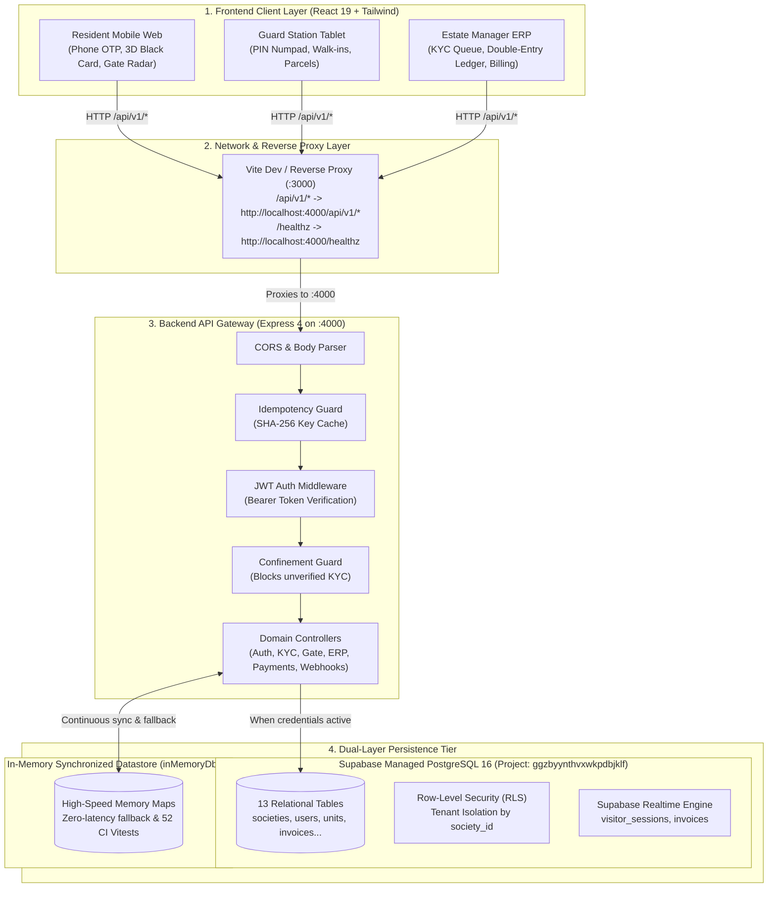
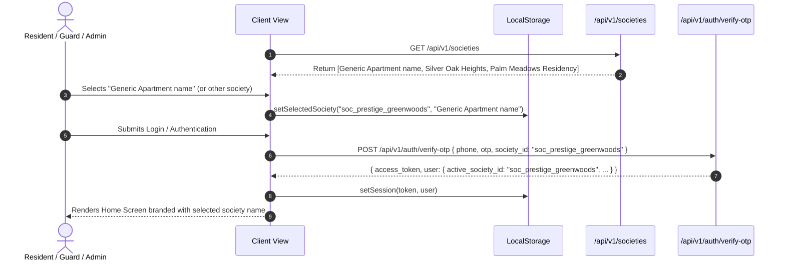
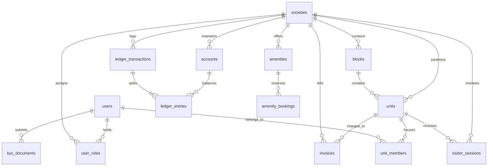
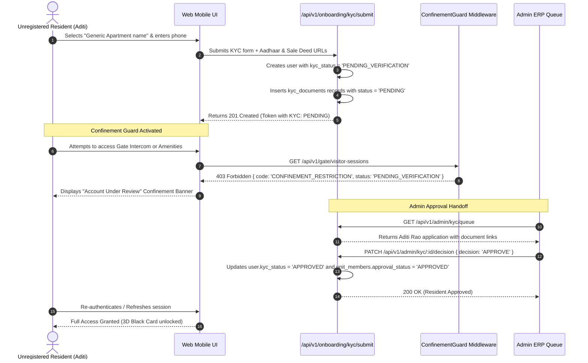
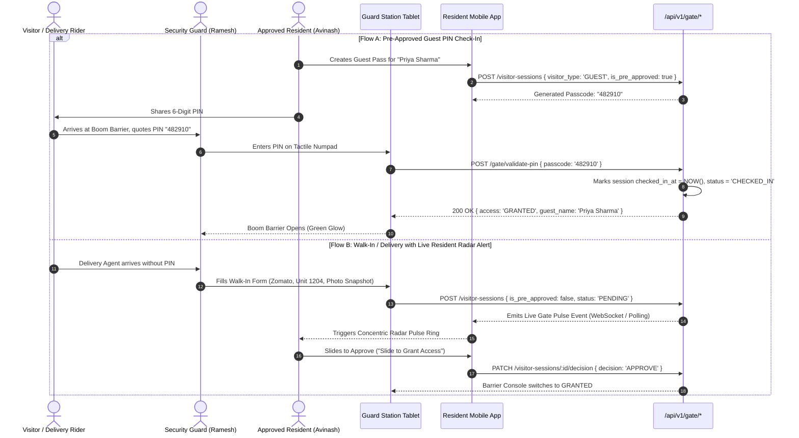
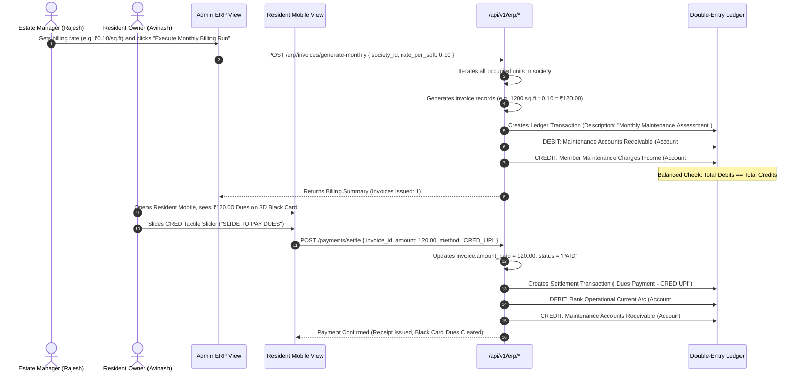
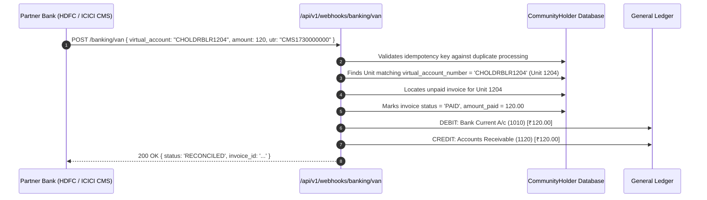

# CommunityHolder: Backend Connection, Data Storage & Workflow Handoffs

This document provides a transparent, end-to-end breakdown of how CommunityHolder connects its frontend interfaces to the backend services, how data is organized and stored across the database tiers, and how data handoffs occur across system boundaries.

---

## 1. System Topology & Connection Architecture

The application implements a decoupled, three-tier architecture with a unified RESTful API layer and a dual-layer persistence model.



### How the Frontend Connects to the Backend
1. **Network Proxy (`apps/web/vite.config.ts`)**:
   - The React frontend runs on port `3000`.
   - All network requests targeting `/api` or `/healthz` are automatically reverse-proxied to `http://localhost:4000` where the Express API is listening.
   - This eliminates browser CORS complications in development and ensures seamless local and containerized operation.

2. **HTTP Client (`apps/web/src/api/client.ts`)**:
   - The singleton `ApiClient` manages sessions via browser `localStorage`:
     - `ch_token`: Signed JWT authentication bearer token.
     - `ch_user`: Current serialized user object including role list and KYC status.
     - `ch_selected_society_id`: Currently active apartment ID (default: `'soc_prestige_greenwoods'`).
     - `ch_selected_society_name`: Display name of the active apartment (default: `'Generic Apartment name'`).
   - Every outgoing request automatically injects:
     ```http
     Authorization: Bearer <ch_token>
     Content-Type: application/json
     ```

---

## 2. Multi-Apartment / Locality Selection Architecture

CommunityHolder supports multi-tenant society isolation. Users can select their apartment/locality across all three platform interfaces:



### Supported Default Societies
| Society ID | Display Name | Code | Address Street | Bank Prefix |
| :--- | :--- | :--- | :--- | :--- |
| `soc_prestige_greenwoods` | **Generic Apartment name** | `GEN-APT-01` | Main Central Avenue, Layout #1, Bangalore | `CHOLDR` |
| `soc_silver_oak` | **Silver Oak Heights** | `SLV-OAK-02` | 45 Green Valley Road, Bangalore | `SLVOAK` |
| `soc_palm_meadows` | **Palm Meadows Residency** | `PLM-MDW-03` | 12 Lakeview Boulevard, Bangalore | `PLMMDW` |

---

## 3. Database Schema & Relational Model

The database schema is defined in [`supabase/migrations/20261106_init_communityholder_schema.sql`](file:///Users/avinasharadya88/Documents/CommunityHolder/supabase/migrations/20261106_init_communityholder_schema.sql) and hosted on Supabase Cloud PostgreSQL 16 (Project `ggzbyynthvxwkpdbjklf`).



### Schema Summary
1. **`societies`**: Multi-tenant partitions representing distinct residential complexes. Contains localized settings for overstay thresholds, IVR timeouts, and annual penalty interest.
2. **`blocks` & `units`**: Structural hierarchy. Every unit has a square footage rating (for maintenance calculations) and a unique Virtual Account Number (`virtual_account_number`) for automated bank reconciliation.
3. **`users`**: Master user identity table storing normalized E.164 phone numbers, KYC verification status (`UNREGISTERED`, `PENDING_VERIFICATION`, `APPROVED`, `REJECTED`), and profile metadata.
4. **`user_roles`**: Granular role assignments per society (`RESIDENT_OWNER`, `RESIDENT_TENANT`, `SECURITY_GUARD`, `ESTATE_MANAGER`, `SOCIETY_ADMIN`).
5. **`unit_members`**: Binds a user to a specific unit with occupancy classification (`PRIMARY_OWNER`, `TENANT`, `FAMILY_MEMBER`).
6. **`kyc_documents`**: Stores legal property documents (Aadhaar, Sale Deed, Rental Agreement) with SHA-256 integrity hashes, verification notes, and auditor stamps.
7. **`visitor_sessions`**: Real-time gate passes, photo snapshots, 6-digit barrier passcodes, overstay flags, and check-in/out timestamps.
8. **`accounts`, `invoices`, `ledger_transactions`, `ledger_entries`**: Indian Accounting Standard (Ind AS) compliant double-entry general ledger. Every billing run and payment creates balanced debit and credit entries.
9. **`helpdesk_tickets` & `amenities`**: Operational workflows for maintenance tickets with SLA tracking and clubhouse amenity slot reservations.

---

## 4. End-to-End Workflow Data Handoffs

### Handoff 1: Resident Registration & Confinement Mode Guard


### Handoff 2: Gatekeeper Radar Pulse & PIN Barrier Check-in


### Handoff 3: Monthly Maintenance Billing & Double-Entry Ledger


### Handoff 4: Banking VAN (Virtual Account Number) Webhook Ingestion


---

## 5. DPDPA (Digital Personal Data Protection Act) Retention Handoff

In compliance with India's **DPDPA 2023** standards:
- Any visitor photo snapshots, license plate images, or facial captures collected at the guard barrier are stamped with `checked_in_at` and society retention policy (`auto_purge_visitor_days: 90`).
- The scheduled maintenance job calls:
  ```http
  POST /api/v1/admin/maintenance/purge-old-visitor-photos
  ```
- The backend identifies records older than the retention threshold and nullifies `photo_url` (`photo_url = NULL`, `status = 'PURGED'`), preserving the audit session trail while purging personal biometrics.

---

## 6. Supabase Cloud Configuration Guide

| Parameter | Configuration |
| :--- | :--- |
| **Supabase Project** | `ggzbyynthvxwkpdbjklf` |
| **Dashboard URL** | [https://supabase.com/dashboard/project/ggzbyynthvxwkpdbjklf](https://supabase.com/dashboard/project/ggzbyynthvxwkpdbjklf) |
| **REST API Base URL** | `https://ggzbyynthvxwkpdbjklf.supabase.co` |
| **Database Host** | `db.ggzbyynthvxwkpdbjklf.supabase.co` (Port 5432) |
| **Migration Script** | `supabase/migrations/20261106_init_communityholder_schema.sql` |

### Running the Schema Migration in Supabase
1. Open the [Supabase SQL Editor](https://supabase.com/dashboard/project/ggzbyynthvxwkpdbjklf/sql).
2. Copy the contents of [`supabase/migrations/20261106_init_communityholder_schema.sql`](file:///Users/avinasharadya88/Documents/CommunityHolder/supabase/migrations/20261106_init_communityholder_schema.sql).
3. Click **Run**. This will create all 13 tables, apply RLS policies, enable Realtime streams, and seed the default societies ("Generic Apartment name", "Silver Oak Heights", "Palm Meadows Residency") along with sample blocks, units, users, and ledger accounts.
