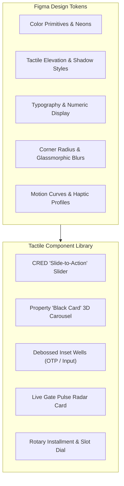

# CommunityHolder UI/UX Design System Specification
## CRED-Inspired Dark Luxury & Tactile Neumorphism for Smart Community Management

---

| **Document Version** | 1.0.0 |
| **Status** | Approved for Figma Prototyping & Flutter/Web Theming |
| **Design Language** | Neo-Brutal Dark Luxury, Tactile Neumorphism (Soft UI 2.0) & Neon Cyber Accents |
| **Inspiration Source** | CRED App (Craft, Physics, Tactility, Minimalist Typography & Signature Slider Gestures) |
| **Target Platforms** | iOS Mobile, Android Mobile, Gatekeeper Tablet, Web Admin Portal |

---

## 1. Design Philosophy & Visual Aesthetic

Traditional housing society applications suffer from utilitarian, cluttered, and uninspired interfaces characterized by standard material blue navigation bars, dense unstyled text, and unengaging forms.

**CommunityHolder** reimagines community living through the iconic visual language of **CRED**:
1. **Obsidian Dark Luxury Canvas**: A distraction-free, pure deep-slate palette that feels exclusive, high-end, and easy on the eyes in low-light environments.
2. **Tactile Neumorphism (Dual-Light Shadows)**: UI elements are not flat planes—they possess physical volume, bevels, soft elevations, and debossed inset wells that invite touch.
3. **High-Contrast Neon Cyber Accents**: Strategic flashes of vibrant neon (Mint `#00F5A0`, Electric Violet `#7C5CFC`, Sunset Amber `#FFB800`, Crimson `#FF3366`) create focal points and communicate real-time security states.
4. **Frictionless Haptic & Spring Physics**: Critical security and financial actions feature deliberate, rewarding gestures like the signature **"Slide-to-Approve"** and **"Slide-to-Pay"** pill sliders with non-linear spring physics and haptic ticks.
5. **Editorial Typography & Hero Metrics**: Bold geometric titles, letterspaced uppercase microcopy, and giant monospace financial numbers that convey clarity and authority.

---

## 2. Figma Design System Tokens (DTCG Standard)



### 2.1 Color Palette & Semantic Tokens

```json
{
  "color": {
    "background": {
      "canvas": { "value": "#0A0B0E", "description": "Deep obsidian master background" },
      "surface_base": { "value": "#121318", "description": "Primary card and container background" },
      "surface_elevated": { "value": "#181A22", "description": "Elevated interactive cards and modals" },
      "surface_recessed": { "value": "#07080A", "description": "Debossed input wells and track backgrounds" }
    },
    "border": {
      "hairline_subtle": { "value": "rgba(255, 255, 255, 0.07)", "description": "Subtle metallic card rim" },
      "hairline_focus": { "value": "rgba(0, 245, 160, 0.35)", "description": "Active focus state highlight" },
      "divider": { "value": "rgba(255, 255, 255, 0.04)", "description": "Section separators" }
    },
    "text": {
      "primary": { "value": "#F8FAFC", "description": "High-contrast headings and active values" },
      "secondary": { "value": "#94A3B8", "description": "Labels, descriptions, secondary values" },
      "muted": { "value": "#475569", "description": "Timestamps, placeholder text, inactive tabs" },
      "inverse": { "value": "#0A0B0E", "description": "Text placed inside vibrant neon buttons" }
    },
    "accent": {
      "neon_mint": {
        "base": { "value": "#00F5A0" },
        "glow": { "value": "rgba(0, 245, 160, 0.28)" },
        "description": "Gate entry approved, verified KYC badge, payment cleared"
      },
      "electric_violet": {
        "base": { "value": "#7C5CFC" },
        "glow": { "value": "rgba(124, 92, 252, 0.25)" },
        "description": "Property card accents, VIP guest passes, premium club amenities"
      },
      "sunset_amber": {
        "base": { "value": "#FFB800" },
        "glow": { "value": "rgba(255, 184, 0, 0.22)" },
        "description": "Pending verification, invoice due soon, overstay warning"
      },
      "neon_crimson": {
        "base": { "value": "#FF3366" },
        "glow": { "value": "rgba(255, 51, 102, 0.35)" },
        "description": "SOS emergency trigger, gate denied, overdue dues"
      }
    }
  }
}
```

### 2.2 Tactile Neumorphic Elevation & Shadow Tokens

In Figma, Neumorphic shadows use dual-directional light sources (top-left highlight + bottom-right shadow) to give buttons and cards their physical volume:

```css
/* Level 0: Recessed / Inset (Input Fields, Slider Track, OTP Wells) */
box-shadow: inset 3px 3px 8px rgba(0, 0, 0, 0.85), 
            inset -3px -3px 8px rgba(255, 255, 255, 0.03);

/* Level 1: Subtle Elevated Tile (Quick Actions, Staff Badges, List Items) */
box-shadow: 6px 6px 14px rgba(0, 0, 0, 0.70), 
            -4px -4px 10px rgba(255, 255, 255, 0.03);

/* Level 2: Floating Primary Card (Property Black Card, Live Gate Pulse Card) */
box-shadow: 12px 12px 28px rgba(0, 0, 0, 0.85), 
            -6px -6px 16px rgba(255, 255, 255, 0.04);

/* Level 3: Active Neon Glow (Slider Knob, Emergency SOS, Action Buttons) */
box-shadow: 0px 0px 30px rgba(0, 245, 160, 0.35), 
            8px 8px 24px rgba(0, 0, 0, 0.90);
```

### 2.3 Typography & Numeric Hierarchy

| Token Name | Font Family | Size / Line-Height | Weight | Tracking (Letterspacing) | Usage |
|---|---|---|---|---|---|
| `display-hero` | *Plus Jakarta Sans* | 44px / 48px | Bold (700) | `-0.03em` | Financial Balances, Welcome Hero |
| `display-numeric` | *JetBrains Mono* | 36px / 40px | SemiBold (600) | `-0.02em` | OTP Display, Unit Numbers (`A-1204`), Passcodes |
| `title-h1` | *Plus Jakarta Sans* | 26px / 32px | Bold (700) | `-0.02em` | Screen Titles, Modal Headlines |
| `title-h2` | *Plus Jakarta Sans* | 20px / 26px | SemiBold (600) | `-0.01em` | Card Headings, Section Headers |
| `body-emphasis` | *Inter* | 15px / 22px | Medium (500) | `0` | Action Descriptions, Visitor Details |
| `body-regular` | *Inter* | 14px / 20px | Regular (400) | `0` | Paragraphs, Form Helper Text |
| `caption-mono` | *JetBrains Mono* | 11px / 14px | Medium (500) | `+0.16em` | Uppercase Tags (`VERIFIED`, `OWNER`, `GATE: NORTH`) |

---

## 3. Signature CRED-Style Component Architecture

### 3.1 The CommunityHolder Tactile "Slide-to-Action" (CRED Slider)
The centerpiece of the application experience. Replaces mundane push buttons with a high-deliberation tactile slider that prevents accidental gate approvals or financial transactions.

```
CRED-Style Slide-to-Approve Component Anatomy
+--------------------------------------------------------------------------+
|  [ DEBOSSED TRACK: Inset Shadow | #08090C | Radius: 9999px ]             |
|                                                                          |
|  +--------+                                                              |
|  |  (>>)  |   >>>  S L I D E   T O   A P P R O V E   G U E S T  >>>      |
|  +--------+                                                              |
|  Thumb Knob: Elevated Neon Mint (#00F5A0) | Ambient Glow | Haptic Engine  |
+--------------------------------------------------------------------------+
```

#### Interaction Physics & Haptics:
1. **Resting State**: The track pulses with a subtle, rhythmic linear gradient shimmer across the label text: `SLIDE TO APPROVE GUEST`.
2. **Drag Gesture**:
   - The thumb knob follows horizontal touch with a slight non-linear resistance.
   - For every 10% movement, the device triggers an ultra-light selection haptic click.
   - The track fill behind the knob illuminates in translucent neon green (`rgba(0, 245, 160, 0.15)`).
3. **Threshold & Spring Release**:
   - If released before **85% width**, the knob snaps back elastically to the left edge with a `cubic-bezier(0.175, 0.885, 0.32, 1.275)` spring bounce.
   - If crossed past **85%**, the thumb locks to the right edge with a sharp, heavy confirmation haptic buzz.
4. **Completion Bloom**:
   - The icon morphs smoothly from `>>` to a checkmark `✓`.
   - A localized radial micro-particle explosion and glow halo blooms outwards.
   - The gate barrier trigger is fired instantly.

### 3.2 The Property "Black Card" 3D Carousel
Residents who own multiple flats, or split between being an owner in one community and a tenant in another, navigate between properties via a stack of physical, tactile **Black Cards**:

```
+------------------------------------------------------------------+
|  GENERIC APARTMENT NAME                   [ CH RESTRICTED CREST ]|
|  Tower Alpha • Flat 1204                                         |
|                                                                  |
|  CURRENT BALANCE                       VERIFIED STATUS           |
|  $ 120.00                              [ V RESIDENT OWNER ]      |
|                                                                  |
|  Due in 4 Days • No Overdue Charges    VAN: CHOLDRBLR1204        |
+------------------------------------------------------------------+
```
- **Surface**: Metallic brushed obsidian texture with a faint diagonal reflection line.
- **Micro-Interaction**: Gyroscope-driven 3D tilt (card leans slightly in 3D perspective as the resident tilts their smartphone).
- **Carousel Flow**: Swiping vertically smoothly brings the next property card to the front with scale and opacity interpolation (`scale: 0.92 -> 1.0`, `z-index: 1 -> 2`).

### 3.3 Debossed Inset OTP & Phone Number Well
- Instead of standard iOS/Android border lines, input fields sit inside **chiseled, recessed wells**.
- The 6-digit OTP fields are isolated square wells.
- Active typing triggers a glowing cyan underglow beneath each entered character.

---

## 4. Complete Screen-by-Screen UI Specifications & Wireframes

### 4.1 Frame 1: Mobile Phone & Country Code Onboarding Screen
```
+--------------------------------------------------------------------------+
|  10:45                                                        5G [====]  |
+--------------------------------------------------------------------------+
|                                                                          |
|  COMMUNITYHOLDER                                          [ LOGO CREST ] |
|  ENTERPRISE LIVING                                                       |
|                                                                          |
|  Enter your mobile number to access                                      |
|  your verified residence.                                                |
|                                                                          |
|  PHONE NUMBER                                                            |
|  +--------------------------------------------------------------------+  |
|  | [ RECESSED DEBOSSED WELL ]                                         |  |
|  |                                                                    |  |
|  |  [ +91 v ]  |  9 8 7 6 5   4 3 2 1 0                               |  |
|  |  (India)    |                                                      |  |
|  +--------------------------------------------------------------------+  |
|  Country code supports India (+91) and all international regions         |
|                                                                          |
|  +--------------------------------------------------------------------+  |
|  |  [ ELEVATED TACTILE BUTTON: NEON MINT #00F5A0 ]                    |  |
|  |                        GET 6-DIGIT OTP                             |  |
|  +--------------------------------------------------------------------+  |
|                                                                          |
|  By continuing, you verify compliance with society security protocols    |
+--------------------------------------------------------------------------+
```

### 4.2 Frame 2: 6-Digit Inset OTP Verification Screen
```
+--------------------------------------------------------------------------+
|  < BACK                                                       5G [====]  |
+--------------------------------------------------------------------------+
|                                                                          |
|  VERIFICATION CODE                                                       |
|  Sent via SMS to +91 98765 43210                                         |
|                                                                          |
|  +------+  +------+  +------+  +------+  +------+  +------+              |
|  |  4   |  |  9   |  |  1   |  |  8   |  |  2   |  |  3   |              |
|  +------+  +------+  +------+  +------+  +------+  +------+              |
|  [ DEBOSSED WELLS WITH ACTIVE NEON CYAN GLOW AROUND FILLED BOXES ]       |
|                                                                          |
|  Resend Code in 00:42s              |          [ Send via WhatsApp ]     |
|                                                                          |
|  +--------------------------------------------------------------------+  |
|  |  [ TACTILE BUTTON: SLATE ELEVATED WITH HAIRLINE SILVER RIM ]       |  |
|  |                       VERIFY & PROCEED                             |  |
|  +--------------------------------------------------------------------+  |
|                                                                          |
+--------------------------------------------------------------------------+
```

### 4.3 Frame 3: First-Time Registration & KYC Document Vault
```
+--------------------------------------------------------------------------+
|  FIRST-TIME REGISTRATION                                      STEP 1 / 2 |
+--------------------------------------------------------------------------+
|  LEGAL DETAILS                                                           |
|  Full Name:        [ Avinash Aradya                                 ]    |
|  Select Society:   [ Generic Apartment name                       v ]    |
|  Block / Unit:     [ Tower Alpha                    ] [ Flat 1204 v ]    |
|  Relationship:     (o) Owner-Occupant   ( ) Tenant   ( ) Landlord        |
|                                                                          |
|  VERIFICATION VAULT (MANDATORY FOR ACCESS)                               |
|                                                                          |
|  +--------------------------------------------------------------------+  |
|  |  1. GOVERNMENT IDENTIFICATION PROOF                                |  |
|  |  Aadhaar Card, Passport, Driving License, or Voter ID             |  |
|  |                                                                    |  |
|  |  [ UPLOAD SLOT: FROSTED GLASS RECESSED WELL ]                      |  |
|  |  [Icon: PDF] aadhaar_card_masked.pdf (2.4 MB)     [ STATUS: READY ] |  |
|  +--------------------------------------------------------------------+  |
|                                                                          |
|  +--------------------------------------------------------------------+  |
|  |  2. PROOF OF PROPERTY OWNERSHIP / LEASE                            |  |
|  |  Registered Sale Deed, Tax Paid Receipt, or Lease Agreement        |  |
|  |                                                                    |  |
|  |  [ UPLOAD SLOT: FROSTED GLASS RECESSED WELL ]                      |  |
|  |  [Icon: PDF] sale_deed_schedule_page.pdf (5.8 MB) [ STATUS: READY ] |  |
|  +--------------------------------------------------------------------+  |
|                                                                          |
|  +--------------------------------------------------------------------+  |
|  |  [ SLIDER: SLIDE TO SUBMIT FOR ESTATE APPROVAL >>> ]               |  |
|  +--------------------------------------------------------------------+  |
|                                                                          |
+--------------------------------------------------------------------------+
```

### 4.4 Frame 4: Application Under Review (Pre-Approval Confinement)
```
+--------------------------------------------------------------------------+
|                                                               5G [====]  |
+--------------------------------------------------------------------------+
|                                                                          |
|                     [ GLOWING ORBITAL SHIELD ICON ]                      |
|                                                                          |
|                         APPLICATION UNDER REVIEW                         |
|                       Generic Apartment name • Flat 1204                  |
|                                                                          |
|  +--------------------------------------------------------------------+  |
|  |  STATUS: PENDING ESTATE MANAGER APPROVAL                           |  |
|  |  Application ID: #CH-88219         Submitted: 10:15 AM Today      |  |
|  |                                                                    |  |
|  |  The Estate and Facility Management team is verifying your        |  |
|  |  submitted Government ID and Property Title Deed against the       |  |
|  |  society master roster.                                            |  |
|  |                                                                    |  |
|  |  Estimated Review SLA:  24 - 48 Hours                              |  |
|  |  Society Office Contact: +91 80 2845 9900                          |  |
|  +--------------------------------------------------------------------+  |
|                                                                          |
|  Documents Submitted:                                                    |
|  - Government ID Proof: Aadhaar Card (Verified Upload)                   |
|  - Property Title Proof: Registered Sale Deed (Verified Upload)          |
|                                                                          |
|  [ REFRESH STATUS ]                          [ VIEW SUBMITTED COPIES ]   |
|                                                                          |
|  Security Note: To protect community privacy, gate access and           |
|  intercom channels remain locked until manual clearance.                 |
+--------------------------------------------------------------------------+
```

### 4.5 Frame 5: Resident Dashboard (Approved State)
```
+--------------------------------------------------------------------------+
|  [Avatar] AVINASH ARADYA                           [SOS: GLOW]  [BELL]   |
+--------------------------------------------------------------------------+
|                                                                          |
|  +--------------------------------------------------------------------+  |
|  |  [ THE BLACK CARD ]                     GENERIC APARTMENT NAME     |  |
|  |                                         Tower Alpha • Flat 1204    |  |
|  |  MAINTENANCE DUES                                                  |  |
|  |  $ 120.00                               [ V ACTIVE OWNER ]         |  |
|  |  Due in 4 Days • No Late Penalty                                   |  |
|  |                                                                    |  |
|  |  +--------------------------------------------------------------+  |  |
|  |  | [ CRED SLIDER: SLIDE TO PAY MAINTENANCE $120.00 >>> ]        |  |  |
|  |  +--------------------------------------------------------------+  |  |
|  +--------------------------------------------------------------------+  |
|                                                                          |
|  LIVE GATE RADAR (1 ACTIVE VISITOR):                                     |
|  +--------------------------------------------------------------------+  |
|  |  [Photo] RAMESH (SWIGGY) • MAIN GATE                      09:32 AM |  |
|  |  Delivery for Flat 1204 • Arrived 42 seconds ago                   |  |
|  |                                                                    |  |
|  |  +--------------------------------------------------------------+  |  |
|  |  | [ CRED SLIDER: >>> SLIDE TO APPROVE ENTRY >>> ]               |  |  |
|  |  +--------------------------------------------------------------+  |  |
|  |                                                                    |  |
|  |  [ CALL GUARD INTERCOM ]                [ LEAVE AT SECURITY GATE ] |  |
|  +--------------------------------------------------------------------+  |
|                                                                          |
|  QUICK TACTILE TILES:                                                    |
|  +--------------------+  +--------------------+  +--------------------+  |
|  |  [QR]              |  |  [Key]             |  |  [Tool]            |  |
|  |  INVITE GUEST      |  |  BOOK AMENITY      |  |  HELPDESK SLA      |  |
|  +--------------------+  +--------------------+  +--------------------+  |
|                                                                          |
|  DOMESTIC STAFF PRESENT ON CAMPUS:                                       |
|  - Sita (House Help): Checked In at 08:15 AM (In Flat)                   |
|  - Anand (Driver): Main Gate Check-in at 09:00 AM                        |
|                                                                          |
|  [ HOME ]          [ GATE ]          [ PAYMENTS ]          [ CLUB ]      |
+--------------------------------------------------------------------------+
```

### 4.6 Frame 6: Incoming Gate Intercom Overlay (WebRTC / VoIP Push)
When a visitor arrives and the guard initiates intercom, the phone screen awakens with CRED-style dark glassmorphism:
```
+--------------------------------------------------------------------------+
|  INCOMING GATE INTERCOM CALL                                  LIVE AUDIO |
+--------------------------------------------------------------------------+
|                                                                          |
|                     [ VISITOR PHOTO IN NEON CIRCLE ]                     |
|                                                                          |
|                              RAMESH KUMAR                                |
|                        Swiggy Delivery • Main Gate                       |
|                                                                          |
|  [ Frosted Audio Visualizer Waves: Fluctuating Cyan Bars ||||||||||| ]   |
|                                                                          |
|  +--------------------------------------------------------------------+  |
|  |  [ CRED SLIDER: >>> SLIDE TO LET IN (OPEN BARRIER) >>> ]          |  |
|  +--------------------------------------------------------------------+  |
|                                                                          |
|  +--------------------------------------------------------------------+  |
|  |  [ BUTTON: LEAVE WITH SECURITY AT GATE ]                           |  |
|  +--------------------------------------------------------------------+  |
|                                                                          |
|  [ X DENY ENTRY ]                                 [ MUTE MICROPHONE ]    |
|                                                                          |
+--------------------------------------------------------------------------+
```

### 4.7 Frame 7: Gatekeeper Tablet (Guard UI — Ultra-Contrast Dark Mode)
Designed for outdoor sunlight and quick 2-second touches by security guards:
```
+----------------------------------------------------------------------------------------------------+
| COMMUNITYHOLDER GATEKEEPER | NORTH GATE TABLET #02                         TIME: 09:34:12 | OK     |
+----------------------------------------------------------------------------------------------------+
|                                                                                                    |
|  +----------------------------------------+  +--------------------------------------------------+  |
|  |  TACTILE GUEST PIN ENTRY (PRE-APPROVED)|  |  WALK-IN QUICK CHECK-IN                          |  |
|  |                                        |  |                                                  |  |
|  |  [ DEBOSSED 6-DIGIT PASSCODE WELL ]    |  |  Select Tower:  [ TOWER ALPHA v ] [ FLAT 1204 v] |  |
|  |    [ 8 ] [ 4 ] [ 9 ] [ 2 ] [ 0 ] [ 1 ] |  |  Visitor Name:  [ Enter Visitor Name           ] |  |
|  |                                        |  |  Visitor Phone: [ Enter Mobile Number          ] |  |
|  |  [ V PASS VALID: ENTRY PERMITTED ]     |  |                                                  |  |
|  |  Guest: Vikram Shah (Flat A-101)       |  |  Quick Aggregators:                              |  |
|  |                                        |  |  [ SWIGGY ]  [ ZOMATO ]  [ AMAZON ]  [ UBER ]    |  |
|  |  [ GREEN NEON: OPEN BOOM BARRIER ]     |  |                                                  |  |
|  +----------------------------------------+  |  [ TAKE VISITOR PHOTO & RING RESIDENT INTERCOM ] |  |
|                                              +--------------------------------------------------+  |
|                                                                                                    |
|  CAMPUS VISITORS CURRENTLY INSIDE (34 ACTIVE):                                                     |
|  +----------------------------------------------------------------------------------------------+  |
|  | Courier 1 (Bluedart) -> Flat B-302 (Inside 12 min)                               [ OK ]      |  |
|  | Guest 2 (Rohan)      -> Flat A-101 (Inside 44 min)                               [! OVERSTAY]|  |
|  +----------------------------------------------------------------------------------------------+  |
|                                                                                                    |
|  [ SCAN STAFF RFID BADGE ]                                          [ EMERGENCY CAMPUS SOS ]       |
+----------------------------------------------------------------------------------------------------+
```

### 4.8 Frame 8: Web Admin / Facility Manager KYC Verification Workspace
The desktop ERP portal adopts the same dark luxury aesthetics, optimized for widescreen dual-pane document audits:
```
+----------------------------------------------------------------------------------------------------+
| COMMUNITYHOLDER ERP | Generic Apartment name Layout                       [Estate Mgr: Rajesh K.]  |
+----------------------------------------------------------------------------------------------------+
| [Overview]   [KYC Verification Queue (8)]   [General Ledger]   [Gate Stream]   [Assets & AMC]      |
+----------------------------------------------------------------------------------------------------+
| Application #CH-88219 | Flat 1204 (Tower Alpha) | Category: Owner-Occupant | Submitted: 10:15 AM   |
+----------------------------------------------------+-----------------------------------------------+
| APPLICANT & TITLE RECORD CROSS-CHECK               | HIGH-RESOLUTION DOCUMENT INSPECTOR            |
+----------------------------------------------------+-----------------------------------------------+
| Full Name:       Avinash Aradya                    | [ TABS: (1) GOVT ID   |  (2) SALE DEED ]      |
| Phone:           +91 98765 43210 (OTP Verified)    |                                               |
| Email:           avinash@example.com               | +-------------------------------------------+ |
| Claimed Unit:    Tower Alpha, Flat 1204            | | [ HIGH-RES CANVAS WITH DYNAMIC WATERMARK] | |
|                                                    | | "CONFIDENTIAL - VERIFIED BY ESTATE MGR"   | |
| Society Master Builder Ledger:                     | |                                           | |
| - Registered Owner: Avinash Aradya                 | | [ Document Image: Clear Aadhaar scan ]    | |
| - Handover Date:    14-October-2025                | | Name: Avinash Aradya (Exact Match)        | |
| - Khata Status:     Form A Khata Cleared           | | UID:  XXXX-XXXX-8821                      | |
| - Maintenance Dues: $0.00 (No Dues Certificate)    | +-------------------------------------------+ |
|                                                    | [ ZOOM + ]   [ ZOOM - ]   [ ROTATE 90° ]    |
+----------------------------------------------------+-----------------------------------------------+
| Internal Review Notes (Recorded in Immutable Audit Log):                                           |
| [ Verified original sale deed schedule and matching government ID. Ready for handover approval.  ] |
|                                                                                                    |
|   [ X REJECT APPLICATION (SPECIFY REASON) ]            [ V VERIFY & APPROVE FULL ACCESS ]          |
+----------------------------------------------------------------------------------------------------+
```

---

## 5. Micro-Interactions, Motion Choreography & Sound Design

### 5.1 Spring Physics & Timing Specs
| Interaction | Easing Curve | Duration | Haptic Feedback |
|---|---|---|---|
| **Slide-to-Approve Drag** | Linear follow with 12% drag damping | Real-time | Continuous subtle click ticks every 24px |
| **Slider Spring Snapback** | `cubic-bezier(0.175, 0.885, 0.32, 1.275)` | 380 ms | Dual light impact on resting wall |
| **Slider Success Lock** | `cubic-bezier(0.2, 1.0, 0.3, 1.0)` | 220 ms | Heavy confirmation thud + particle bloom |
| **Black Card 3D Tilt** | Gyroscope linear matrix interpolation | Real-time | None |
| **Card Switch Transition** | `cubic-bezier(0.25, 1.0, 0.5, 1.0)` | 420 ms | Medium selection impact |
| **SOS Emergency Hold (3s)**| Linear scale from 1.0 to 1.15 | 3000 ms | Rising rhythmic pulsing haptic rumble |

### 5.2 Micro-Sound & Acoustic Feedback (Optional Audio Profile)
- **Gate Pass Issued**: Soft, futuristic double-tone glass chime (`880 Hz -> 1760 Hz`).
- **Slider Release**: Muffled metallic click.
- **Payment Cleared**: Satisfying ascending chord progression (inspired by CRED's coin drop sound).

---

## 6. Implementation Architecture in Flutter & Next.js

### 6.1 Flutter Theme Implementation (`cred_theme.dart`)
```dart
import 'package:flutter/material.dart';

class CredTheme {
  // Dark Luxury Obsidian Palette
  static const Color canvas = Color(0xFF0A0B0E);
  static const Color surfaceBase = Color(0xFF121318);
  static const Color surfaceElevated = Color(0xFF181A22);
  static const Color surfaceRecessed = Color(0xFF07080A);

  // Vibrant Neon Accents
  static const Color neonMint = Color(0xFF00F5A0);
  static const Color electricViolet = Color(0xFF7C5CFC);
  static const Color sunsetAmber = Color(0xFFFFB800);
  static const Color neonCrimson = Color(0xFFFF3366);

  // Neumorphic Box Shadows
  static List<BoxShadow> get tactileElevated => [
    BoxShadow(
      color: Colors.black.withOpacity(0.70),
      offset: const Offset(6, 6),
      blurRadius: 14,
    ),
    BoxShadow(
      color: Colors.white.withOpacity(0.03),
      offset: const Offset(-4, -4),
      blurRadius: 10,
    ),
  ];

  static List<BoxShadow> get tactileGlowMint => [
    BoxShadow(
      color: neonMint.withOpacity(0.35),
      offset: Offset.zero,
      blurRadius: 28,
      spreadRadius: 2,
    ),
    BoxShadow(
      color: Colors.black.withOpacity(0.90),
      offset: const Offset(8, 8),
      blurRadius: 24,
    ),
  ];
}
```

### 6.2 Next.js & Tailwind CSS Tokens (`tailwind.config.ts`)
```typescript
import type { Config } from 'tailwindcss';

const config: Config = {
  darkMode: 'class',
  theme: {
    extend: {
      colors: {
        cred: {
          canvas: '#0A0B0E',
          surface: '#121318',
          elevated: '#181A22',
          recessed: '#07080A',
          mint: '#00F5A0',
          violet: '#7C5CFC',
          amber: '#FFB800',
          crimson: '#FF3366',
        },
      },
      boxShadow: {
        'tactile-card': '6px 6px 14px rgba(0,0,0,0.7), -4px -4px 10px rgba(255,255,255,0.03)',
        'tactile-recessed': 'inset 3px 3px 8px rgba(0,0,0,0.85), inset -3px -3px 8px rgba(255,255,255,0.03)',
        'neon-mint-glow': '0px 0px 28px rgba(0, 245, 160, 0.35), 8px 8px 24px rgba(0,0,0,0.9)',
      },
    },
  },
};
export default config;
```

