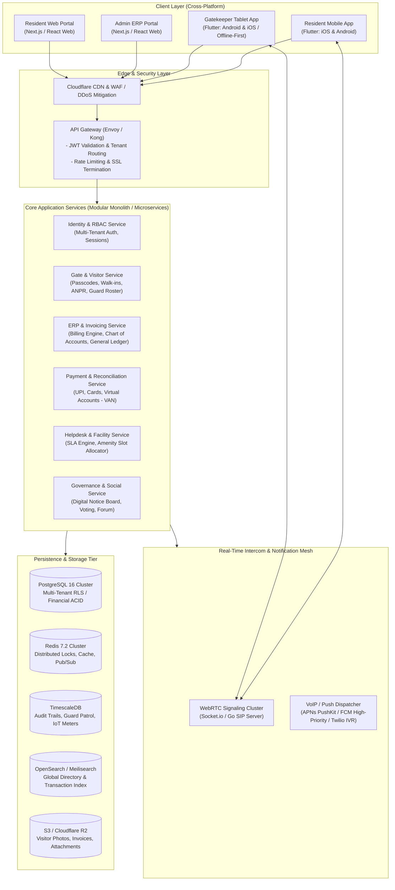
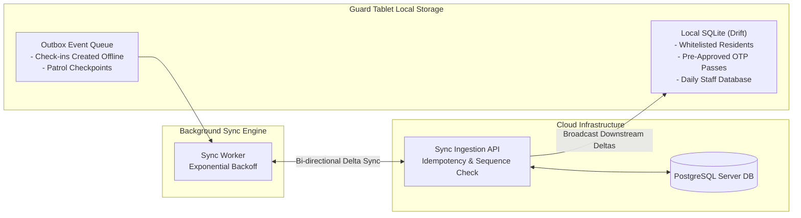

# System Architecture Document
## CommunityHolder — Scalable Multi-Tenant Community & Society ERP Platform

---

| **Document Version** | 1.0.0 |
| **Status** | Approved for Implementation Planning |
| **System Scope** | Client Applications, API Gateway, Microservices, Real-Time Intercom, Offline Sync, Data Layer |
| **Platforms Covered** | iOS Mobile, Android Mobile, Web Responsive Dashboard |

---

## 1. High-Level Architecture Topology

CommunityHolder employs a cloud-native, multi-tenant modular service architecture designed for high availability, sub-second gate validation latency, and bank-grade transactional consistency for financial accounting.



---

## 2. Client Application Architecture

To achieve rapid feature parity across Android, iOS, and Web while maintaining high performance, CommunityHolder utilizes a hybrid frontend strategy:

### 2.1 Mobile Layer: Flutter (iOS & Android)
Both the **Resident App** and the **Gatekeeper Guard App** are engineered in Flutter with a clean feature-driven architecture:
- **Single Source of Truth**: Shared domain models, validation logic, and API clients across resident and guard binaries.
- **Hardware Integration**: High-speed camera preview for visitor photo capture, NFC/Barcode scanners for staff badges and patrol tags, and Bluetooth Low Energy (BLE) for resident vehicle access tags.
- **VoIP Calling Integration**: Native platform channels binding to **iOS CallKit & PushKit** and **Android ConnectionService** ensuring guard-to-resident video/audio calls ring like native phone calls even when the device is locked.
- **State Management**: BLoC / Riverpod for predictable reactive state management and unit-testability.

```
Flutter Client Architecture (Clean Architecture)
+--------------------------------------------------------------+
| Presentation Layer: Widgets, Screens, BLoC / Riverpod State |
+--------------------------------------------------------------+
| Domain Layer: Use Cases, Entities, Value Objects             |
+--------------------------------------------------------------+
| Data Layer: Repositories, Local DB (Drift/SQLite), REST/gRPC |
+--------------------------------------------------------------+
| Native Bridges: CallKit, CameraX, AVFoundation, Biometrics   |
+--------------------------------------------------------------+
```

### 2.2 Web Layer: Next.js (React 19 / TypeScript / Tailwind CSS)
The **Management Committee ERP Portal** and **Resident Web Portal** are built using Next.js:
- **Server Components & SSR**: Instant load times for dense data grids, financial balance sheets, and administrative dashboards.
- **Responsive Data Grids**: High-performance virtualized tables handling thousands of member transactions, invoicing ledgers, and visitor logs.
- **Role-Based UI Dynamic Rendering**: Granular permission checks hide or reveal financial controls based on committee roles (Treasurer, President, Facility Manager).

---

## 3. Real-Time Intercom & Gate Notification Architecture

One of the core reverse-engineered features of ADDA Gatekeeper is the **Guard-to-Resident Intercom**. In traditional apartments, hardwired intercoms fail frequently. CommunityHolder provides a cloud-native, reliable software intercom:

```mermaid
sequenceDiagram
    autonumber
    actor G as Security Guard (Tablet)
    participant S as Gatekeeper Service
    participant R as Real-Time Signaling Engine
    participant P as VoIP / Push Dispatcher
    actor U as Resident (Phone)

    G->>S: 1. Submit Visitor Check-In (Photo + Flat A-402)
    S->>S: 2. Create Visitor Session (Status: PENDING)
    S->>R: 3. Broadcast Incoming Gate Event
    R->>P: 4. Dispatch APNs VoIP Push (iOS) / High-Priority FCM (Android)
    P->>U: 5. Wake Device & Trigger Native Call Screen (CallKit / ConnectionService)
    
    alt Resident Approves
        U->>R: 6a. Tap "Approve" (WebSocket Ack)
        R->>S: 7a. Transition Visitor Status to "APPROVED"
        S->>G: 8a. Guard Screen Shows Green "Approved" + Trigger Boom Barrier
    else Resident Initiates Audio Intercom
        U->>R: 6b. Tap "Talk to Visitor"
        R->>G: 7b. Establish WebRTC Peer Connection (STUN/TURN)
        U<-->>G: 8b. Two-Way Low-Latency Audio Stream (Opus Codec)
        U->>R: 9b. Tap "Approve Entry"
        R->>G: 10b. Pass Issued
    else No Response within 30s
        S->>P: 6c. Trigger Automated Telephony IVR Fallback Call
        P->>U: 7c. Phone Rings via PSTN ("Press 1 to Approve Entry")
    end
```

---

## 4. Offline-First Guard Synchronization Architecture

Security gates often experience network instability. A guard cannot make visitors wait because Wi-Fi dropped. CommunityHolder implements a **Local-First, Event-Sourced Sync Topology** on guard devices:



### 4.1 Sync Protocol Rules
1. **Read Availability**: Every guard tablet keeps a locally cached, encrypted snapshot of:
   - All flats and active resident contact IDs.
   - All expected pre-approved visitor passes and 6-digit PINs valid for the current day.
   - All registered domestic staff profiles and authorized entry badges.
2. **Offline Check-in**:
   - Pre-approved PINs are validated against local SQLite without network round-trips (< 200ms).
   - Walk-in check-ins are recorded into the `Outbox` queue with a client-generated UUID, timestamp, and local photo path.
3. **Delta Reconciliation & Conflict Resolution**:
   - Once online, the `SyncWorker` streams outbox events to `/api/v1/gate/sync-batch`.
   - Idempotency keys prevent duplicate pass issuance.
   - If a resident revoked an access pass while the guard was offline, the server returns a `REVOKED_CONFLICT` status, alerting the guard tablet.

---

## 5. Multi-Tenant Data Architecture & Database Partitioning

Housing society management requires strict multi-tenant isolation, data privacy compliance, and atomic financial accounting.

### 5.1 Tenant Isolation Strategy: Row-Level Security (RLS)
CommunityHolder utilizes a **Shared Database, Shared Schema with PostgreSQL Row-Level Security (RLS)**:
- Every table includes a mandatory `society_id UUID NOT NULL` foreign key.
- Each connection session sets `SET LOCAL app.current_society_id = '...'`.
- PostgreSQL policies strictly prevent cross-tenant queries at the database engine level:
```sql
ALTER TABLE units ENABLE ROW LEVEL SECURITY;
CREATE POLICY society_isolation_policy ON units
    USING (society_id = current_setting('app.current_society_id')::uuid);
```

### 5.2 Storage Separation Matrix
| Data Type | Primary Store | Caching / Secondary | Retention / Purge Policy |
|---|---|---|---|
| **Core Entities (Users, Units, Societies)** | PostgreSQL 16 | Redis Cache (TTL: 1 hr) | Persistent |
| **Financial Ledger & Invoices** | PostgreSQL (ACID) | Immutable Ledger Table | 7 Years (Statutory Audit Requirement) |
| **Visitor Entries & Gate Logs** | PostgreSQL | TimescaleDB partition | Auto-purge photos after 90 days; metadata 1 year |
| **Guard Patrol Telemetry** | TimescaleDB | Redis Geo | 6 Months |
| **Media (Visitor Faces, Invoices, Bills)** | Cloudflare R2 / S3 | Cloudflare Edge Cache | Automatic lifecycle deletion rules |
| **Distributed Locks (Double-Booking)** | Redis 7.2 (Redlock) | In-Memory | TTL: 60 seconds |

---

## 6. Financial Engine Architecture (Double-Entry ERP)

To match and exceed ADDA's accounting capabilities, CommunityHolder implements an **immutable double-entry general ledger**:

```
General Ledger Transaction Structure
+---------------------------------------------------------------------------------+
| Transaction Header: ID, SocietyID, Date, Reference (Invoice/Receipt #), Status  |
+---------------------------------------------------------------------------------+
| Lines (Debits MUST Equal Credits):                                              |
| - Line 1: Debit  | Account: 1010-Bank HDFC      | $120.00 | Desc: Maintenance   |
| - Line 2: Credit | Account: 4010-Member Maint   | $100.00 | Desc: Flat A-101    |
| - Line 3: Credit | Account: 2050-GST Output     | $ 20.00 | Desc: 18% GST       |
+---------------------------------------------------------------------------------+
```

### 6.1 Automated Virtual Account Number (VAN) Processing
1. Partner bank (ICICI / HDFC / RazorpayX) generates unique virtual account numbers for each flat: `CHOLDR + [SOCIETY_CODE] + [UNIT_NO]`.
2. When a resident pays via NEFT/RTGS/IMPS, the bank webhooks the payload to CommunityHolder's `/api/v1/webhooks/banking/van`.
3. The webhook engine matches the account suffix to the unit, creates an automated receipt, posts equal debit/credit entries to the ledger, and sends the resident an instant push receipt.

---

## 7. Security, Privacy & DPDPA Compliance Architecture

Residential data includes sensitive personal information (PII), entry/exit timestamps of family members, and high-value financial data. CommunityHolder implements a **Zero-Trust Security Framework**:

1. **Phone Number Masking**:
   - Guards and delivery drivers never see a resident's raw telephone number.
   - In-app calling routes through WebRTC or an anonymized cloud telephony proxy (Twilio/Exotel).
2. **Data Minimization & Auto-Purging**:
   - Visitor facial photos captured at the gate are encrypted at rest with AES-256-GCM.
   - An automated background worker deletes raw facial images from storage after 90 days, retaining only anonymized visitor metadata for society security statistics.
3. **Role-Based Access Control (RBAC)**:
   - Strict privilege matrix enforced through Casbin / Cedar policy engine:
     - `RESIDENT`: Read own unit, book amenities, pre-approve guests, view public notices.
     - `GUARD`: Create visitor sessions, scan patrol tags, read domestic staff badges. No access to financial ledgers or resident balance dues.
     - `ACCOUNTANT`: Full access to Chart of Accounts, Invoices, Bank Reconciliations. No access to gate visitor logs or panic alerts.
     - `ADMIN / PRESIDENT`: Full administrative oversight with mandatory two-factor authentication (2FA).
4. **Audit Logging**:
   - Every administrative data access, permission modification, and ledger adjustment generates an immutable SHA-256 chained audit record.

---

## 8. Deployment, CI/CD & Infrastructure Topology

```
+------------------------------------------------------------------------------+
| Cloud Infrastructure (AWS / GCP / Cloudflare)                                |
+------------------------------------------------------------------------------+
| Ingress: Cloudflare DNS -> Cloudflare WAF -> AWS ALB / NLB                  |
| Compute: Kubernetes (EKS) Cluster                                            |
|   - Namespace: production-communityholder                                    |
|   - Ingress Controller: Envoy                                                |
|   - Pod Autoscaling: KEDA (CPU, Memory, and Queue Depth metric triggers)    |
|   - Core Pods: api-gateway, gate-service, erp-service, intercom-signaling   |
| Database: AWS Aurora PostgreSQL (Multi-AZ) with Read Replicas                |
| In-Memory: ElastiCache Redis Cluster (Multi-AZ)                              |
| Storage: Cloudflare R2 / AWS S3 with KMS Customer Managed Keys               |
| Observability: Datadog / OpenTelemetry + Grafana + Sentry Crash Reporting    |
+------------------------------------------------------------------------------+
```
