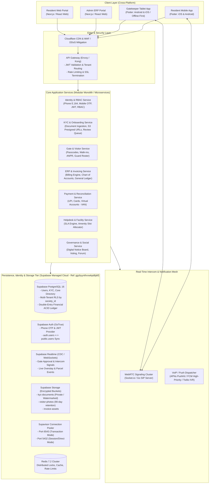
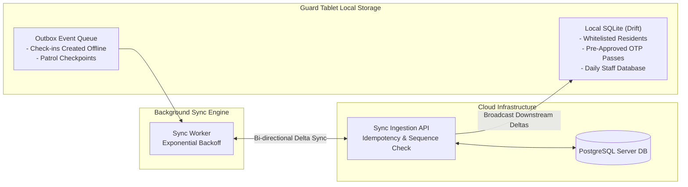

# System Architecture Document
## CommunityHolder — Scalable Multi-Tenant Community & Society ERP Platform

---

| **Document Version** | 1.0.0 |
| **Status** | Approved for Implementation Planning |
| **System Scope** | Client Applications, API Gateway, Microservices, Real-Time Intercom, Offline Sync, Data Layer |
| **Platforms Covered** | iOS Mobile, Android Mobile, Web Responsive Dashboard |

---

## 1. High-Level Architecture Topology

CommunityHolder employs a cloud-native, multi-tenant modular service architecture designed for high availability, sub-second gate validation latency, and bank-grade transactional consistency for financial accounting.



### 1.1 Managed Database & Cloud Infrastructure (Supabase Project Instance)

The persistent user data, society hierarchy, financial general ledger, and access tokens are managed via the dedicated Supabase cloud infrastructure:

| Parameter | Configuration / Value | Description |
|---|---|---|
| **Supabase Project URL** | `https://ggzbyynthvxwkpdbjklf.supabase.co` | Main API Gateway and Storage Endpoint |
| **Supabase Dashboard** | [`https://supabase.com/dashboard/project/ggzbyynthvxwkpdbjklf`](https://supabase.com/dashboard/project/ggzbyynthvxwkpdbjklf) | Administrative Management Console |
| **Project Reference ID** | `ggzbyynthvxwkpdbjklf` | Unique multi-tenant cloud project identifier |
| **Database Host** | `db.ggzbyynthvxwkpdbjklf.supabase.co` | Managed PostgreSQL 16 Relational Engine |
| **Connection Pooling (Supavisor)** | `aws-0-ap-south-1.pooler.supabase.com:6543` | High-concurrency Transaction Pooling (Port 6543) |
| **Direct DB Connection** | `db.ggzbyynthvxwkpdbjklf.supabase.co:5432` | Schema migrations, DDL, and administrative scripts |
| **Realtime WebSocket Server** | `wss://ggzbyynthvxwkpdbjklf.supabase.co/realtime/v1/websocket` | CDC broadcast for gate ring & visitor events |
| **Storage Engine** | Supabase Storage (S3 API compatible) | Dedicated encrypted buckets (`kyc-documents`, `visitor-photos`) |

---

## 2. Client Application Architecture

To achieve rapid feature parity across Android, iOS, and Web while maintaining high performance, CommunityHolder utilizes a hybrid frontend strategy:

### 2.1 Mobile Layer: Flutter (iOS & Android)
Both the **Resident App** and the **Gatekeeper Guard App** are engineered in Flutter with a clean feature-driven architecture:
- **Single Source of Truth**: Shared domain models, validation logic, and API clients across resident and guard binaries.
- **Hardware Integration**: High-speed camera preview for visitor photo capture, NFC/Barcode scanners for staff badges and patrol tags, and Bluetooth Low Energy (BLE) for resident vehicle access tags.
- **VoIP Calling Integration**: Native platform channels binding to **iOS CallKit & PushKit** and **Android ConnectionService** ensuring guard-to-resident video/audio calls ring like native phone calls even when the device is locked.
- **State Management**: BLoC / Riverpod for predictable reactive state management and unit-testability.

```
Flutter Client Architecture (Clean Architecture)
+--------------------------------------------------------------+
| Presentation Layer: Widgets, Screens, BLoC / Riverpod State |
+--------------------------------------------------------------+
| Domain Layer: Use Cases, Entities, Value Objects             |
+--------------------------------------------------------------+
| Data Layer: Repositories, Local DB (Drift/SQLite), REST/gRPC |
+--------------------------------------------------------------+
| Native Bridges: CallKit, CameraX, AVFoundation, Biometrics   |
+--------------------------------------------------------------+
```

### 2.2 Web Layer: Next.js (React 19 / TypeScript / Tailwind CSS)
The **Management Committee ERP Portal** and **Resident Web Portal** are built using Next.js:
- **Server Components & SSR**: Instant load times for dense data grids, financial balance sheets, and administrative dashboards.
- **Responsive Data Grids**: High-performance virtualized tables handling thousands of member transactions, invoicing ledgers, and visitor logs.
- **Role-Based UI Dynamic Rendering**: Granular permission checks hide or reveal financial controls based on committee roles (Treasurer, President, Facility Manager).

---

## 3. Strict Role-Based Identity, Phone OTP & KYC Onboarding Architecture

```mermaid
sequenceDiagram
    autonumber
    actor U as Resident Applicant
    participant C as Mobile / Web Client
    participant G as API Gateway (Envoy)
    participant I as Identity & Auth Service (Supabase Auth / GoTrue)
    participant DB as Supabase PostgreSQL (public.users)
    participant K as KYC Onboarding Service
    participant S3 as Supabase Storage (kyc-documents Bucket)
    actor A as Admin / Estate / Facility Manager

    Note over U,DB: Phase 1: Mobile Phone + Country Code OTP Login
    U->>C: 1. Enter Country Code (+91 / Intl) & Phone Number
    C->>G: 2. POST /api/v1/auth/request-otp (E.164 phone)
    G->>I: 3. Validate Format (libphonenumber) & Dispatch OTP via Supabase Auth SMS Provider
    I->>U: 4. Dispatch 6-Digit OTP via SMS (Twilio/MessageBird) / WhatsApp Fallback
    U->>C: 5. Input 6-Digit OTP
    C->>G: 6. POST /api/v1/auth/verify-otp
    G->>I: 7. Verify OTP against Supabase Auth (auth.users)
    I->>DB: 8. Trigger syncs/verifies record in public.users
    I-->>C: 9. Return Session JWT (Role: APPLICANT, kyc_status: UNREGISTERED, sub: user_id)

    Note over U,S3: Phase 2: First-Time Registration & KYC Document Upload
    U->>C: 10. Select Society, Block, Unit & Role (Owner/Tenant)
    C->>K: 11. Request Presigned Upload URLs for Supabase Storage
    K-->>C: 12. Return Signed Upload URLs for kyc-documents bucket (Content-Type & Hash locked)
    C->>S3: 13. Direct Client-to-Supabase Storage Upload (AES-256 Server Encryption)
    C->>K: 14. Submit KYC Application (Metadata + Supabase Storage Object Keys)
    K->>DB: 15. Insert into public.kyc_documents; update public.users (kyc_status = PENDING_VERIFICATION)
    K-->>A: 16. Broadcast Real-Time Alert to Estate/Facility Manager Queue via Supabase Realtime

    Note over A,U: Phase 3: Manual Verification & Access Provisioning
    A->>K: 17. Open Pending Review Dashboard (Inspect ID & Title/Lease)
    alt Approved by Estate / Facility Manager
        A->>K: 18a. Click "Verify & Approve Access"
        K->>DB: 19a. Upgrade User Role (OWNER/TENANT), set public.users kyc_status = APPROVED
        K->>U: 20a. Dispatch Push/SMS: "Access Approved! Welcome to your Community"
        Note over U: App unblocks full Gate, ERP & Community features
    else Rejected by Estate / Facility Manager
        A->>K: 18b. Select "Reject" + Mandatory Reason ("Blurred ID / Name mismatch")
        K->>DB: 19b. Set public.users kyc_status = REJECTED (Attach rejection reason)
        K->>U: 20b. Dispatch Alert with Rejection Reason & Re-upload Action
    end
```

### 3.1 Global Phone Number Ingestion & OTP Verification Pipeline
1. **E.164 Normalization Engine**:
   - Integrated with Google's `libphonenumber` across Flutter, Web, and backend microservices.
   - Parses, validates, and normalizes phone numbers against international carriers and dial plans:
     - **India (`+91`)**: Validates 10-digit mobile series starting with 6, 7, 8, 9.
     - **International Numbers**: Normalizes country calling code, national destination code (NDC), and subscriber number (SN) across US/Canada (`+1`), UK (`+44`), UAE (`+971`), Singapore (`+65`), Australia (`+61`), etc.
2. **Supabase Auth Engine Integration**:
   - Managed authentication powered by Supabase Auth (GoTrue).
   - Generates cryptographically random 6-digit OTP tokens delivered via SMS provider integrations (Twilio, Gupshup, MessageBird).
   - Rate limiting and brute-force throttling enforced via token-bucket algorithm (maximum 3 failed verification attempts per window).

### 3.2 Secure KYC Document Ingestion & Storage Architecture (Supabase Storage)
1. **Presigned Upload Pipeline via Supabase Storage**:
   - Clients never stream heavy document binaries through application servers.
   - The KYC Service interacts with Supabase Storage API (`https://ggzbyynthvxwkpdbjklf.supabase.co/storage/v1/`) to issue short-lived (15-minute) signed upload URLs for the `kyc-documents` bucket.
   - Upload restrictions enforced:
     - Allowed MIME types: `image/jpeg`, `image/png`, `application/pdf`.
     - File size capped at 10 MB per document.
     - Content SHA-256 verification hash recorded in `public.kyc_documents`.
2. **Storage Security & Encryption at Rest**:
   - Stored in private, non-public Supabase Storage buckets with server-side AES-256-GCM encryption.
   - Direct bucket access is blocked; document viewing in the Admin Review Queue generates dynamic, watermarked, short-lived (60-second) signed URLs accessible strictly to authorized Estate Managers with full audit trail logging.

### 3.3 Strict Role-Based Access Control (RBAC) & Confinement Middleware
1. **JWT Claims Contract**:
   Every issued access token contains:
   ```json
   {
     "sub": "user_uuid_here",
     "phone": "+919876543210",
     "society_id": "society_uuid_here",
     "unit_id": "unit_uuid_here",
     "roles": ["RESIDENT_OWNER"],
     "kyc_status": "APPROVED",
     "exp": 1762410000
   }
   ```
2. **API Gateway Confinement Guard**:
   - The API Gateway executes a centralized **KYC Confinement Guard**:
     - If `kyc_status == 'UNREGISTERED'`: Can only access `/api/v1/onboarding/*` and `/api/v1/societies/lookup`.
     - If `kyc_status == 'PENDING_VERIFICATION'`: Can only access `/api/v1/onboarding/status` and `/api/v1/users/profile`. All calls to Gate, Visitor, Finance, or Community return `403 Forbidden (KYC_VERIFICATION_PENDING)`.
     - If `kyc_status == 'REJECTED'`: Can only access the re-upload endpoint `/api/v1/onboarding/resubmit`.
     - If `kyc_status == 'APPROVED'`: Granted full access corresponding to assigned role.

### 3.4 Role Permission Matrix

| Role | Onboarding & KYC | Gate & Visitors | Intercom | Invoicing & ERP | Helpdesk | Admin Verification Queue |
|---|---|---|---|---|---|---|
| **APPLICANT (Unverified)** | Upload Docs / View Status | ❌ Blocked | ❌ Blocked | ❌ Blocked | ❌ Blocked | ❌ Blocked |
| **RESIDENT_OWNER** | View Status | Full Access | Full Access | View & Pay | Create / Rate | ❌ Blocked |
| **RESIDENT_TENANT** | View Status | Full Access | Full Access | View & Pay Utilities | Create / Rate | ❌ Blocked |
| **SECURITY_GUARD** | N/A | Check-in / Outbox | Gate-to-Phone | ❌ Blocked | View Campus Ops | ❌ Blocked |
| **FACILITY / ESTATE MANAGER** | N/A | View Logs | ❌ Blocked | Work Orders / POs | Manage / Assign | **Full Review & Approve** |
| **SOCIETY ADMIN / PRESIDENT** | N/A | Full Oversight | Emergency Intercom | Full ERP / Ledger | Escalate | **Full Review & Approve** |

---

## 4. Real-Time Intercom & Gate Notification Architecture

One of the core reverse-engineered features of ADDA Gatekeeper is the **Guard-to-Resident Intercom**. In traditional apartments, hardwired intercoms fail frequently. CommunityHolder provides a cloud-native, reliable software intercom:

```mermaid
sequenceDiagram
    autonumber
    actor G as Security Guard (Tablet)
    participant S as Gatekeeper Service
    participant R as Real-Time Signaling Engine
    participant P as VoIP / Push Dispatcher
    actor U as Resident (Phone)

    G->>S: 1. Submit Visitor Check-In (Photo + Flat A-402)
    S->>S: 2. Create Visitor Session (Status: PENDING)
    S->>R: 3. Broadcast Incoming Gate Event
    R->>P: 4. Dispatch APNs VoIP Push (iOS) / High-Priority FCM (Android)
    P->>U: 5. Wake Device & Trigger Native Call Screen (CallKit / ConnectionService)
    
    alt Resident Approves
        U->>R: 6a. Tap "Approve" (WebSocket Ack)
        R->>S: 7a. Transition Visitor Status to "APPROVED"
        S->>G: 8a. Guard Screen Shows Green "Approved" + Trigger Boom Barrier
    else Resident Initiates Audio Intercom
        U->>R: 6b. Tap "Talk to Visitor"
        R->>G: 7b. Establish WebRTC Peer Connection (STUN/TURN)
        U<-->>G: 8b. Two-Way Low-Latency Audio Stream (Opus Codec)
        U->>R: 9b. Tap "Approve Entry"
        R->>G: 10b. Pass Issued
    else No Response within 30s
        S->>P: 6c. Trigger Automated Telephony IVR Fallback Call
        P->>U: 7c. Phone Rings via PSTN ("Press 1 to Approve Entry")
    end
```

---

## 5. Offline-First Guard Synchronization Architecture

Security gates often experience network instability. A guard cannot make visitors wait because Wi-Fi dropped. CommunityHolder implements a **Local-First, Event-Sourced Sync Topology** on guard devices:



### 4.1 Sync Protocol Rules
1. **Read Availability**: Every guard tablet keeps a locally cached, encrypted snapshot of:
   - All flats and active resident contact IDs.
   - All expected pre-approved visitor passes and 6-digit PINs valid for the current day.
   - All registered domestic staff profiles and authorized entry badges.
2. **Offline Check-in**:
   - Pre-approved PINs are validated against local SQLite without network round-trips (< 200ms).
   - Walk-in check-ins are recorded into the `Outbox` queue with a client-generated UUID, timestamp, and local photo path.
3. **Delta Reconciliation & Conflict Resolution**:
   - Once online, the `SyncWorker` streams outbox events to `/api/v1/gate/sync-batch`.
   - Idempotency keys prevent duplicate pass issuance.
   - If a resident revoked an access pass while the guard was offline, the server returns a `REVOKED_CONFLICT` status, alerting the guard tablet.

---

## 6. Multi-Tenant Data Architecture & Supabase Database Infrastructure (Project: ggzbyynthvxwkpdbjklf)

CommunityHolder utilizes a managed **Supabase PostgreSQL 16** cloud database cluster hosted on AWS (`ap-south-1`) as its central system of record for all user data, housing society hierarchies, gate security logs, and double-entry financial ledgers.

- **Supabase Management Dashboard**: [`https://supabase.com/dashboard/project/ggzbyynthvxwkpdbjklf`](https://supabase.com/dashboard/project/ggzbyynthvxwkpdbjklf)
- **Supabase Project Reference ID**: `ggzbyynthvxwkpdbjklf`
- **Database Engine**: PostgreSQL 16.x with `pgcrypto`, `uuid-ossp`, `citext`, and Row-Level Security (RLS) extensions.

```mermaid
flowchart TD
    subgraph SupabasePlatform["Supabase Cloud Platform (Project: ggzbyynthvxwkpdbjklf)"]
        subgraph AuthLayer["Supabase Auth (GoTrue Engine)"]
            AU["auth.users<br/>- User UUID (sub)<br/>- Phone (E.164 normalized)<br/>- Phone Confirmed At<br/>- Encrypted Metadata"]
        end

        subgraph DbPublic["PostgreSQL 16 Engine (public schema)"]
            PU["public.users<br/>(Profile, E.164, KYC Status)"]
            UR["public.user_roles<br/>(Role, Society ID, Permissions)"]
            UM["public.unit_members<br/>(Unit ID, Occupancy Status)"]
            KD["public.kyc_documents<br/>(Govt ID, Property Proof, Review)"]
            SOC["public.societies & units<br/>(Buildings, Flats, VAN prefixes)"]
            VS["public.visitor_sessions<br/>(Passcodes, Gate Logs, Overstay)"]
            ERP["public.accounts & invoices<br/>(Double-Entry General Ledger)"]
        end

        subgraph RealtimeLayer["Supabase Realtime (CDC)"]
            RT["PostgreSQL WAL Replication<br/>Broadcast: visitor_sessions, tickets, dues"]
        end

        subgraph StorageLayer["Supabase Storage (Encrypted S3-compatible Buckets)"]
            B1["Bucket: kyc-documents (Private, 10MB)"]
            B2["Bucket: visitor-photos (Private, 90-day auto-purge)"]
            B3["Bucket: invoice-assets (Private, PDF ledgers)"]
        end
    end

    AU -->|Postgres Trigger: handle_new_user()| PU
    PU --> UR
    PU --> UM
    PU --> KD
    VS -.->|Publication: supabase_realtime| RT
    KD -.->|Storage Object Reference| B1
    VS -.->|Storage Object Reference| B2
```

### 6.1 Where and How User Data is Stored

All user identity, demographic profile, occupancy, and compliance records are stored across tightly synchronized schemas within the Supabase PostgreSQL database:

1. **Authentication Identity & Credentials (`auth.users`)**:
   - Stored in the protected Supabase `auth` schema managed by GoTrue.
   - Holds the primary cryptographic identity: User `id` (UUIDv4), `phone` (normalized E.164 format, e.g. `+919876543210`), `phone_confirmed_at`, `last_sign_in_at`, and JWT signing metadata.
   - Passwords are not used; authentication is entirely passwordless via cryptographic phone OTP.

2. **Application User Profile (`public.users`)**:
   - Stored in the `public` schema in the Supabase database.
   - Primary key `id UUID` directly references `auth.users(id) ON DELETE CASCADE`.
   - Stores:
     - `country_code` (e.g. `+91`, `+1`, `+44`, `+971`).
     - `national_number` (e.g. `9876543210`).
     - `phone_e164` (Normalized international format, indexed uniquely).
     - `full_name` (Applicant legal name).
     - `avatar_url` (Profile photo in Supabase Storage).
     - `kyc_status` (`UNREGISTERED`, `PENDING_VERIFICATION`, `UNDER_REVIEW`, `APPROVED`, `REJECTED`).
     - `rejection_reason` (Mandatory explanation if KYC was declined by estate manager).
     - `is_active` (Account operational state).
     - `created_at`, `updated_at`.

3. **Multi-Tenant Role Permissions (`public.user_roles`)**:
   - Maps each `user_id` to a specific `society_id` and role:
     - `RESIDENT_OWNER`: Full access to owned unit, gate approvals, maintenance dues.
     - `RESIDENT_TENANT`: Full access to rented unit, gate approvals, utility bills.
     - `SECURITY_GUARD`: Gatekeeper tablet access, visitor walk-in creation, PIN barrier verification.
     - `FACILITY_MANAGER` / `ESTATE_MANAGER`: KYC review queue, AMC vendor tracking, work orders.
     - `SOCIETY_ADMIN` / `PRESIDENT`: Complete administrative oversight, full double-entry accounting ledger.

4. **Apartment Occupancy Mapping (`public.unit_members`)**:
   - Maps `user_id` to physical society units (`unit_id` and `society_id`).
   - Tracks member occupancy category (`PRIMARY_OWNER`, `CO_OWNER`, `TENANT`, `FAMILY_MEMBER`), primary emergency contact flag, and move-in/move-out validity dates.

5. **KYC Documents & Verification Trail (`public.kyc_documents`)**:
   - Metadata record for every uploaded proof:
     - `document_category`: `GOVT_ID` (Aadhaar, Passport, Driving License) or `PROPERTY_PROOF` (Sale Deed, Possession Letter, Registered Rent Agreement).
     - `file_url`: Private Supabase Storage path in the `kyc-documents` bucket.
     - `file_sha256`: Cryptographic integrity checksum.
     - `status`: `PENDING`, `VERIFIED`, `REJECTED`.
     - `verified_by`: User UUID of the Estate/Facility Manager who audited the document.
     - `verification_notes`: Timestamps and audit remarks.

### 6.2 Automated Synchronization: `auth.users` to `public.users`

Whenever a resident signs up or verifies their phone OTP in Supabase Auth, an automated database trigger creates or synchronizes their application profile in `public.users`:

```sql
-- Trigger Function: Sync Supabase Auth to Public Profile
CREATE OR REPLACE FUNCTION public.handle_new_user()
RETURNS TRIGGER AS $$
BEGIN
    INSERT INTO public.users (id, phone_e164, country_code, national_number, full_name, kyc_status)
    VALUES (
        NEW.id,
        NEW.phone,
        COALESCE(NEW.raw_user_meta_data->>'country_code', '+91'),
        COALESCE(NEW.raw_user_meta_data->>'national_number', SUBSTRING(NEW.phone FROM 4)),
        COALESCE(NEW.raw_user_meta_data->>'full_name', 'Resident Applicant'),
        'UNREGISTERED'
    )
    ON CONFLICT (id) DO UPDATE
    SET phone_e164 = EXCLUDED.phone_e164,
        updated_at = NOW();
    RETURN NEW;
END;
$$ LANGUAGE plpgsql SECURITY DEFINER;

CREATE TRIGGER on_auth_user_created
    AFTER INSERT ON auth.users
    FOR EACH ROW EXECUTE FUNCTION public.handle_new_user();
```

### 6.3 Tenant Isolation Strategy: Row-Level Security (RLS)

CommunityHolder strictly isolates all multi-tenant queries at the database engine level via PostgreSQL Row-Level Security (RLS) configured in Supabase:

1. **User Profile Policy**:
   Users can read and update only their own profile, while Estate Managers and Admins can view residents belonging to their authorized society:
   ```sql
   ALTER TABLE public.users ENABLE ROW LEVEL SECURITY;

   CREATE POLICY users_self_access ON public.users
       FOR ALL USING (auth.uid() = id);

   CREATE POLICY users_admin_society_access ON public.users
       FOR SELECT USING (
           EXISTS (
               SELECT 1 FROM public.user_roles ur
               WHERE ur.user_id = auth.uid()
                 AND ur.role IN ('SOCIETY_ADMIN', 'FACILITY_MANAGER')
                 AND ur.society_id IN (
                     SELECT um.society_id FROM public.unit_members um WHERE um.user_id = public.users.id
                 )
           )
       );
   ```

2. **Multi-Tenant Society Isolation**:
   Every operational table (`units`, `visitor_sessions`, `invoices`, `helpdesk_tickets`) enforces tenant scoping using the `society_id` embedded in the Supabase JWT claims or role context:
   ```sql
   ALTER TABLE public.units ENABLE ROW LEVEL SECURITY;

   CREATE POLICY units_society_isolation ON public.units
       FOR ALL USING (
           society_id = (auth.jwt() -> 'app_metadata' ->> 'society_id')::uuid
       );
   ```

### 6.4 Supabase Connection Pooling Architecture (Supavisor)

To handle thousands of concurrent gate scans, mobile app launches, and ERP report queries without exhausting PostgreSQL connection limits, CommunityHolder connects via **Supavisor**:

| Connection Mode | Port | Host Endpoint | Usage |
|---|---|---|---|
| **Transaction Pooler** | `6543` | `aws-0-ap-south-1.pooler.supabase.com` | High-frequency API microservices, Express routes, serverless background workers |
| **Session Pooler** | `5432` | `aws-0-ap-south-1.pooler.supabase.com` | Long-lived WebSocket connections, stateful sessions |
| **Direct Connection** | `5432` | `db.ggzbyynthvxwkpdbjklf.supabase.co` | Prisma / Drizzle / Flyway schema migrations, DDL execution, admin scripts |

### 6.5 Supabase Storage Buckets for Documents & Media

Document and image assets are stored in private Supabase Storage buckets located within the project:

1. **`kyc-documents` Bucket**:
   - **Access**: Strictly private. Direct public access is disabled.
   - **Allowed MIME types**: `application/pdf`, `image/jpeg`, `image/png`.
   - **Max file size**: 10 MB per file.
   - **Access Policy**: Accessible only to the uploading applicant (via `auth.uid()`) and authorized Facility/Estate Managers of the corresponding society via 60-second temporary signed URLs.
2. **`visitor-photos` Bucket**:
   - **Access**: Private.
   - **Allowed MIME types**: `image/jpeg`, `image/png`.
   - **Retention & Auto-Purge**: In accordance with DPDPA 2023 compliance, images are automatically purged by scheduled database worker after 90 days.
3. **`invoice-assets` Bucket**:
   - **Access**: Private.
   - **Allowed MIME types**: `application/pdf`.
   - **Access Policy**: Readable only by the unit resident and society finance committee.

### 6.6 Supabase Realtime Engine (PostgreSQL CDC)

Instant push notifications and UI updates are driven by the Supabase Realtime engine via PostgreSQL logical replication:
- **`visitor_sessions`**: Notifies the Resident Mobile App immediately when a guard logs a visitor at the gate, initiating the intercom ring.
- **`helpdesk_tickets`**: Broadcasts SLA ticket status updates to residents and facility technicians.
- **`invoices`**: Triggers real-time dues clearance animations upon receipt of bank VAN payments.

```sql
-- Enable Realtime publication on critical operational tables
ALTER PUBLICATION supabase_realtime ADD TABLE public.visitor_sessions;
ALTER PUBLICATION supabase_realtime ADD TABLE public.helpdesk_tickets;
ALTER PUBLICATION supabase_realtime ADD TABLE public.invoices;
```

### 6.7 Storage Separation Matrix

| Data Type | Primary Store (Supabase Instance: `ggzbyynthvxwkpdbjklf`) | Caching / Secondary | Retention / Purge Policy |
|---|---|---|---|
| **User Profiles & Identity** | Supabase `auth.users` + `public.users` | Redis Cache (TTL: 1 hr) | Persistent (Archived on account closure) |
| **Roles & Occupancy** | Supabase `public.user_roles`, `public.unit_members` | Redis Session Cache | Persistent (Revoked on move-out) |
| **KYC Legal Documents** | Supabase Storage (`kyc-documents` bucket) + metadata in `public.kyc_documents` | Cloudflare Edge Cache (Private) | Retained for tenancy duration + statutory period |
| **Financial Ledger & Invoices** | Supabase `public.accounts`, `public.ledger_entries` (ACID) | Immutable Ledger Table | 7 Years (Statutory Audit Requirement) |
| **Visitor Entries & Gate Logs** | Supabase `public.visitor_sessions` | TimescaleDB partition | Photos purged after 90 days (DPDPA); metadata 1 year |
| **Guard Patrol Telemetry** | Supabase PostgreSQL / TimescaleDB | Redis Geo | 6 Months |
| **Media (Visitor Faces, Bills)**| Supabase Storage (`visitor-photos`, `invoice-assets`) | Signed URLs (60s TTL) | Auto-purged via background lifecycle jobs |
| **Distributed Locks (Booking)** | Redis 7.2 (Redlock) | In-Memory | TTL: 60 seconds |

---

## 7. Financial Engine Architecture (Double-Entry ERP)

To match and exceed ADDA's accounting capabilities, CommunityHolder implements an **immutable double-entry general ledger**:

```
General Ledger Transaction Structure
+---------------------------------------------------------------------------------+
| Transaction Header: ID, SocietyID, Date, Reference (Invoice/Receipt #), Status  |
+---------------------------------------------------------------------------------+
| Lines (Debits MUST Equal Credits):                                              |
| - Line 1: Debit  | Account: 1010-Bank HDFC      | $120.00 | Desc: Maintenance   |
| - Line 2: Credit | Account: 4010-Member Maint   | $100.00 | Desc: Flat A-101    |
| - Line 3: Credit | Account: 2050-GST Output     | $ 20.00 | Desc: 18% GST       |
+---------------------------------------------------------------------------------+
```

### 7.1 Automated Virtual Account Number (VAN) Processing
1. Partner bank (ICICI / HDFC / RazorpayX) generates unique virtual account numbers for each flat: `CHOLDR + [SOCIETY_CODE] + [UNIT_NO]`.
2. When a resident pays via NEFT/RTGS/IMPS, the bank webhooks the payload to CommunityHolder's `/api/v1/webhooks/banking/van`.
3. The webhook engine matches the account suffix to the unit, creates an automated receipt, posts equal debit/credit entries to the ledger, and sends the resident an instant push receipt.

---

## 8. Security, Privacy & DPDPA Compliance Architecture

Residential data includes sensitive personal information (PII), entry/exit timestamps of family members, and high-value financial data. CommunityHolder implements a **Zero-Trust Security Framework**:

1. **Phone Number Masking**:
   - Guards and delivery drivers never see a resident's raw telephone number.
   - In-app calling routes through WebRTC or an anonymized cloud telephony proxy (Twilio/Exotel).
2. **Data Minimization & Auto-Purging**:
   - Visitor facial photos captured at the gate are encrypted at rest with AES-256-GCM.
   - An automated background worker deletes raw facial images from storage after 90 days, retaining only anonymized visitor metadata for society security statistics.
3. **Role-Based Access Control (RBAC)**:
   - Strict privilege matrix enforced through Casbin / Cedar policy engine:
     - `RESIDENT`: Read own unit, book amenities, pre-approve guests, view public notices.
     - `GUARD`: Create visitor sessions, scan patrol tags, read domestic staff badges. No access to financial ledgers or resident balance dues.
     - `ACCOUNTANT`: Full access to Chart of Accounts, Invoices, Bank Reconciliations. No access to gate visitor logs or panic alerts.
     - `ADMIN / PRESIDENT`: Full administrative oversight with mandatory two-factor authentication (2FA).
4. **Audit Logging**:
   - Every administrative data access, permission modification, and ledger adjustment generates an immutable SHA-256 chained audit record.

---

## 9. Deployment, CI/CD & Infrastructure Topology

```
+----------------------------------------------------------------------------------------------------+
| Cloud Infrastructure Topology (Supabase Managed Cloud + Containerized Compute)                     |
+----------------------------------------------------------------------------------------------------+
| Ingress: Cloudflare DNS -> Cloudflare WAF / DDoS -> Application Load Balancers                     |
| Compute: Kubernetes (EKS) / Cloud Run Containers                                                   |
|   - Namespace: production-communityholder                                                          |
|   - Ingress Gateway: Envoy (JWT Verification, E.164 phone normalization, rate limits)              |
|   - Core Microservices: api-gateway, gate-service, erp-service, intercom-signaling                 |
| Managed Data Tier (Supabase Instance: ggzbyynthvxwkpdbjklf):                                       |
|   - Database: Supabase PostgreSQL 16 (AWS ap-south-1) with native Row-Level Security (RLS)         |
|   - Connection Pooling: Supavisor Transaction Pooler (Port 6543) & Session Pooler (Port 5432)     |
|   - Identity & Auth: Supabase Auth (GoTrue Engine) with Phone OTP Providers                        |
|   - Realtime Engine: Supabase Realtime (CDC / Logical Replication WebSockets)                      |
|   - Encrypted Storage: Supabase Storage Buckets (kyc-documents, visitor-photos, invoice-assets)    |
| In-Memory Cache: ElastiCache Redis 7.2 Cluster (Distributed Redlock & Rate-Limiting Token Buckets) |
| Observability: OpenTelemetry + Prometheus + Grafana + Sentry Crash Reporting                       |
+----------------------------------------------------------------------------------------------------+
```
