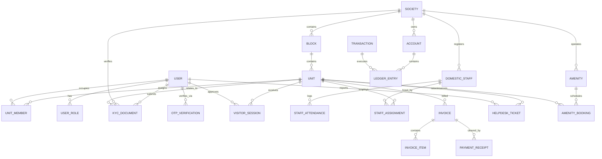
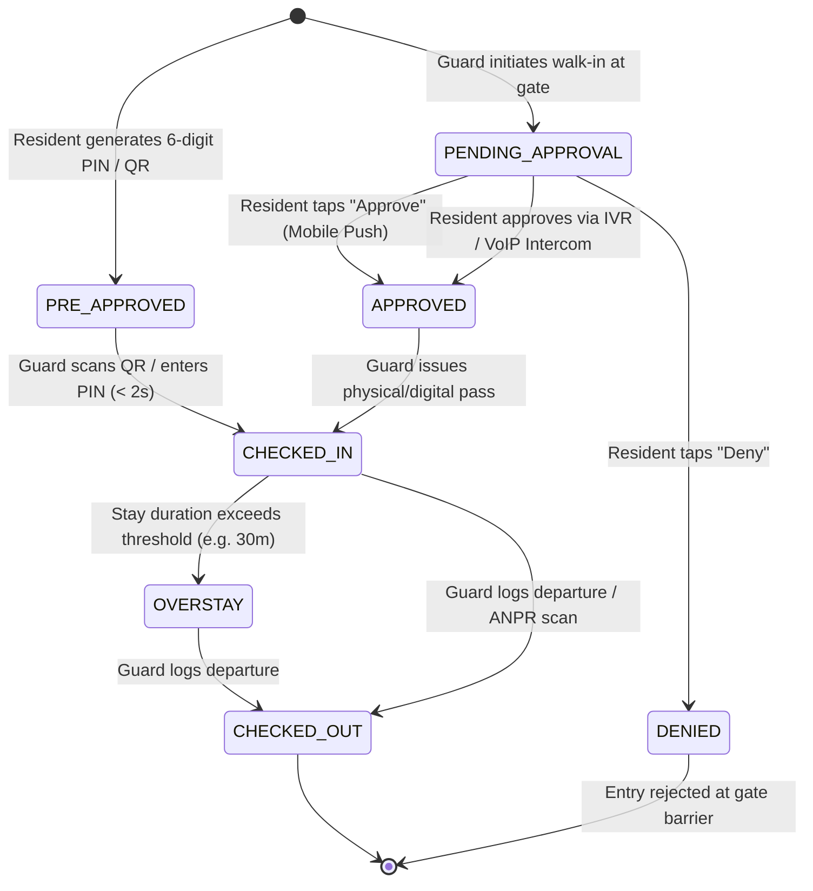
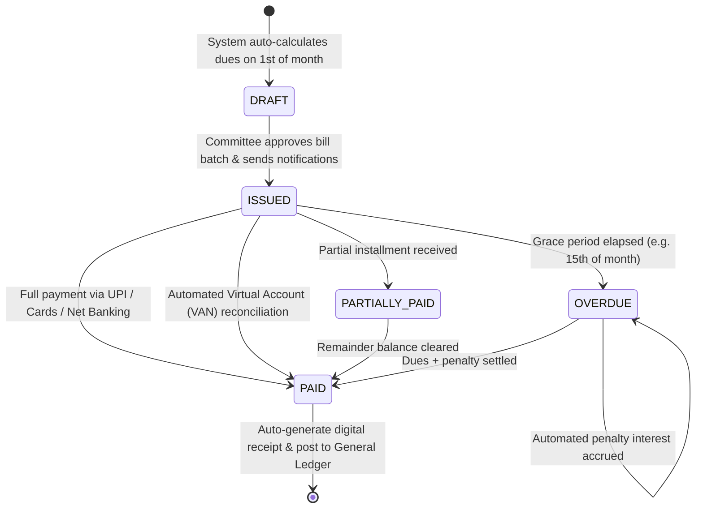
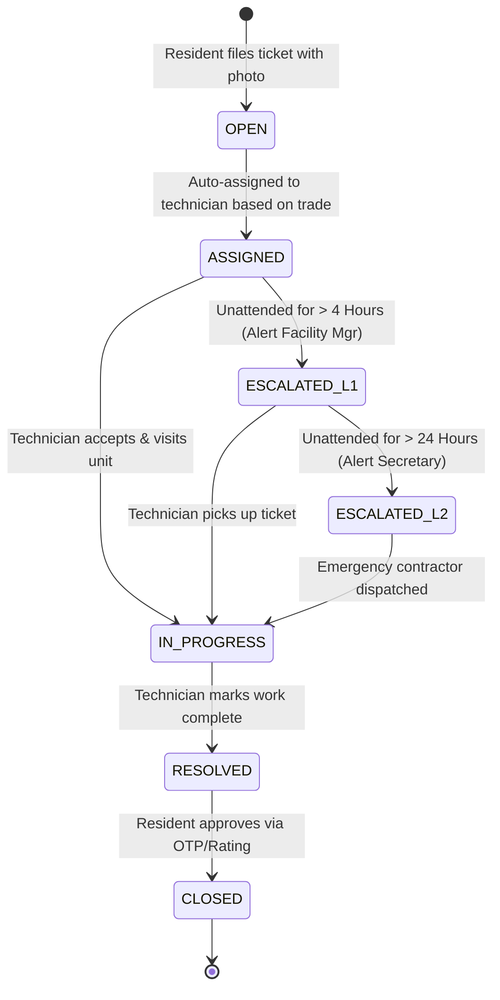

# System & Technical Design Document
## CommunityHolder — Engineering Specifications, Data Models & UI/UX Design

---

| **Document Version** | 1.0.0 |
| **Status** | Approved for Implementation |
| **Document Purpose** | Comprehensive Database DDL, State Machines, API Specifications, and UI/UX Design System |
| **Target Implementation** | Cross-Platform (Flutter Mobile, Next.js Web, NestJS/PostgreSQL Backend) |

---

## 1. Domain Entity Relationship & Data Models

The following ER diagram maps the primary entities across society hierarchy, security, ERP, and operations:



---

## 2. Core Relational Database DDL (PostgreSQL 16)

```sql
-- Enable necessary extensions
CREATE EXTENSION IF NOT EXISTS "uuid-ossp";
CREATE EXTENSION IF NOT EXISTS "citext";
CREATE EXTENSION IF NOT EXISTS "pgcrypto";

-- ============================================================================
-- 1. SOCIETY & PROPERTY HIERARCHY
-- ============================================================================

CREATE TABLE societies (
    id UUID PRIMARY KEY DEFAULT uuid_generate_v4(),
    name VARCHAR(255) NOT NULL,
    code VARCHAR(16) NOT NULL UNIQUE, -- e.g. "BLR-GRN-01"
    address_street TEXT NOT NULL,
    city VARCHAR(100) NOT NULL,
    state VARCHAR(100) NOT NULL,
    postal_code VARCHAR(20) NOT NULL,
    country VARCHAR(10) NOT NULL DEFAULT 'IN',
    van_bank_prefix VARCHAR(10) UNIQUE, -- Virtual Account prefix (e.g. "CHOLDR")
    gstin VARCHAR(20),
    timezone VARCHAR(50) DEFAULT 'Asia/Kolkata',
    settings JSONB NOT NULL DEFAULT '{
        "visitor_photo_required": true,
        "overstay_alert_minutes": 30,
        "ivr_fallback_timeout_seconds": 30,
        "auto_purge_visitor_days": 90,
        "late_payment_penalty_rate_annual": 18.0
    }',
    created_at TIMESTAMPTZ NOT NULL DEFAULT NOW(),
    updated_at TIMESTAMPTZ NOT NULL DEFAULT NOW()
);

CREATE TABLE blocks (
    id UUID PRIMARY KEY DEFAULT uuid_generate_v4(),
    society_id UUID NOT NULL REFERENCES societies(id) ON DELETE CASCADE,
    name VARCHAR(100) NOT NULL, -- e.g. "Tower Alpha", "Block B"
    total_floors INT NOT NULL DEFAULT 1,
    created_at TIMESTAMPTZ NOT NULL DEFAULT NOW()
);

CREATE TABLE units (
    id UUID PRIMARY KEY DEFAULT uuid_generate_v4(),
    society_id UUID NOT NULL REFERENCES societies(id) ON DELETE CASCADE,
    block_id UUID NOT NULL REFERENCES blocks(id) ON DELETE CASCADE,
    unit_number VARCHAR(50) NOT NULL, -- e.g. "101", "Penthouse 4"
    super_built_up_area NUMERIC(10, 2) NOT NULL, -- in sq.ft or sq.m
    carpet_area NUMERIC(10, 2),
    occupancy_status VARCHAR(20) NOT NULL DEFAULT 'VACANT', -- VACANT, OWNER_OCCUPIED, TENANT_OCCUPIED
    virtual_account_number VARCHAR(50) UNIQUE, -- e.g. "CHOLDRBLRGRN101"
    created_at TIMESTAMPTZ NOT NULL DEFAULT NOW(),
    UNIQUE(society_id, block_id, unit_number)
);

-- ============================================================================
-- 2. USERS, AUTHENTICATION & KYC ONBOARDING
-- ============================================================================

CREATE TABLE users (
    id UUID PRIMARY KEY DEFAULT uuid_generate_v4(),
    country_code VARCHAR(8) NOT NULL DEFAULT '+91', -- e.g. '+91', '+1', '+44', '+971'
    national_number VARCHAR(20) NOT NULL, -- e.g. '9876543210'
    phone_e164 VARCHAR(30) NOT NULL UNIQUE, -- E.164 normalized: '+919876543210'
    email CITEXT UNIQUE,
    full_name VARCHAR(150) NOT NULL,
    avatar_url TEXT,
    kyc_status VARCHAR(30) NOT NULL DEFAULT 'UNREGISTERED', -- UNREGISTERED, PENDING_VERIFICATION, UNDER_REVIEW, APPROVED, REJECTED
    rejection_reason TEXT,
    is_active BOOLEAN NOT NULL DEFAULT TRUE,
    created_at TIMESTAMPTZ NOT NULL DEFAULT NOW(),
    updated_at TIMESTAMPTZ NOT NULL DEFAULT NOW()
);

CREATE TABLE otp_verifications (
    id UUID PRIMARY KEY DEFAULT uuid_generate_v4(),
    phone_e164 VARCHAR(30) NOT NULL,
    otp_hash VARCHAR(128) NOT NULL,
    channel VARCHAR(20) NOT NULL DEFAULT 'SMS', -- 'SMS' or 'WHATSAPP'
    purpose VARCHAR(30) NOT NULL DEFAULT 'LOGIN', -- 'LOGIN', 'REGISTER', 'KYC_RESUBMIT'
    attempts_count INT NOT NULL DEFAULT 0,
    is_consumed BOOLEAN NOT NULL DEFAULT FALSE,
    expires_at TIMESTAMPTZ NOT NULL,
    created_at TIMESTAMPTZ NOT NULL DEFAULT NOW()
);

CREATE INDEX idx_otp_lookup ON otp_verifications(phone_e164, is_consumed, expires_at);

CREATE TABLE kyc_documents (
    id UUID PRIMARY KEY DEFAULT uuid_generate_v4(),
    user_id UUID NOT NULL REFERENCES users(id) ON DELETE CASCADE,
    society_id UUID NOT NULL REFERENCES societies(id) ON DELETE CASCADE,
    unit_id UUID NOT NULL REFERENCES units(id) ON DELETE CASCADE,
    document_category VARCHAR(30) NOT NULL, -- 'GOVT_ID' or 'PROPERTY_PROOF'
    document_type VARCHAR(50) NOT NULL, -- 'AADHAAR', 'PASSPORT', 'DRIVING_LICENSE', 'VOTER_ID', 'SALE_DEED', 'PROPERTY_TAX_RECEIPT', 'POSSESSION_LETTER', 'RENTAL_AGREEMENT'
    document_identifier_masked VARCHAR(100), -- 'XXXX-XXXX-1234'
    file_url TEXT NOT NULL, -- Private S3/R2 object key
    file_sha256 VARCHAR(64) NOT NULL,
    file_size_bytes BIGINT NOT NULL,
    mime_type VARCHAR(50) NOT NULL, -- 'image/jpeg', 'image/png', 'application/pdf'
    status VARCHAR(30) NOT NULL DEFAULT 'PENDING', -- 'PENDING', 'VERIFIED', 'REJECTED'
    verified_by UUID REFERENCES users(id), -- Estate / Facility Manager ID
    verified_at TIMESTAMPTZ,
    verification_notes TEXT,
    created_at TIMESTAMPTZ NOT NULL DEFAULT NOW()
);

CREATE INDEX idx_kyc_pending_review ON kyc_documents(society_id, status) 
    WHERE status = 'PENDING';

CREATE TABLE unit_members (
    id UUID PRIMARY KEY DEFAULT uuid_generate_v4(),
    unit_id UUID NOT NULL REFERENCES units(id) ON DELETE CASCADE,
    user_id UUID NOT NULL REFERENCES users(id) ON DELETE CASCADE,
    member_type VARCHAR(30) NOT NULL, -- PRIMARY_OWNER, CO_OWNER, TENANT, FAMILY_MEMBER
    is_primary_contact BOOLEAN NOT NULL DEFAULT FALSE,
    approval_status VARCHAR(30) NOT NULL DEFAULT 'PENDING', -- PENDING, APPROVED, REJECTED
    approved_by UUID REFERENCES users(id), -- Admin or Estate Manager who verified KYC
    approved_at TIMESTAMPTZ,
    move_in_date DATE,
    move_out_date DATE,
    created_at TIMESTAMPTZ NOT NULL DEFAULT NOW(),
    UNIQUE(unit_id, user_id)
);

-- ============================================================================
-- 3. GATEKEEPER & VISITOR MANAGEMENT
-- ============================================================================

CREATE TABLE visitor_sessions (
    id UUID PRIMARY KEY DEFAULT uuid_generate_v4(),
    society_id UUID NOT NULL REFERENCES societies(id) ON DELETE CASCADE,
    unit_id UUID NOT NULL REFERENCES units(id) ON DELETE CASCADE,
    visitor_type VARCHAR(30) NOT NULL, -- GUEST, DELIVERY, CAB, SERVICE, CONTRACTOR
    visitor_name VARCHAR(150) NOT NULL,
    visitor_phone VARCHAR(20),
    vehicle_number VARCHAR(30),
    delivery_company VARCHAR(50), -- Amazon, Swiggy, Uber, etc.
    photo_url TEXT,
    passcode VARCHAR(10), -- 6-digit OTP for pre-approvals
    status VARCHAR(30) NOT NULL DEFAULT 'PENDING', -- PENDING, APPROVED, DENIED, CHECKED_IN, CHECKED_OUT, OVERSTAY
    is_pre_approved BOOLEAN NOT NULL DEFAULT FALSE,
    approved_by_user_id UUID REFERENCES users(id),
    guard_id UUID REFERENCES users(id),
    valid_from TIMESTAMPTZ,
    valid_until TIMESTAMPTZ,
    checked_in_at TIMESTAMPTZ,
    checked_out_at TIMESTAMPTZ,
    idempotency_key VARCHAR(64) UNIQUE,
    created_at TIMESTAMPTZ NOT NULL DEFAULT NOW()
);

CREATE INDEX idx_visitor_active ON visitor_sessions(society_id, status) 
    WHERE status IN ('PENDING', 'CHECKED_IN');
CREATE INDEX idx_visitor_passcode ON visitor_sessions(society_id, passcode) 
    WHERE status = 'APPROVED';

-- ============================================================================
-- 4. DOUBLE-ENTRY ACCOUNTING & INVOICING (ERP)
-- ============================================================================

CREATE TABLE accounts (
    id UUID PRIMARY KEY DEFAULT uuid_generate_v4(),
    society_id UUID NOT NULL REFERENCES societies(id) ON DELETE CASCADE,
    account_code VARCHAR(20) NOT NULL, -- 1000 Assets, 2000 Liabilities, 3000 Equity, 4000 Income, 5000 Expense
    account_name VARCHAR(150) NOT NULL,
    account_type VARCHAR(20) NOT NULL, -- ASSET, LIABILITY, EQUITY, REVENUE, EXPENSE
    parent_account_id UUID REFERENCES accounts(id),
    is_active BOOLEAN NOT NULL DEFAULT TRUE,
    created_at TIMESTAMPTZ NOT NULL DEFAULT NOW(),
    UNIQUE(society_id, account_code)
);

CREATE TABLE invoices (
    id UUID PRIMARY KEY DEFAULT uuid_generate_v4(),
    society_id UUID NOT NULL REFERENCES societies(id) ON DELETE CASCADE,
    unit_id UUID NOT NULL REFERENCES units(id) ON DELETE CASCADE,
    invoice_number VARCHAR(50) NOT NULL, -- e.g. "INV-202611-A101"
    bill_date DATE NOT NULL,
    due_date DATE NOT NULL,
    subtotal_amount NUMERIC(12, 2) NOT NULL,
    tax_amount NUMERIC(12, 2) NOT NULL DEFAULT 0.00,
    late_fee_amount NUMERIC(12, 2) NOT NULL DEFAULT 0.00,
    total_amount NUMERIC(12, 2) NOT NULL,
    amount_paid NUMERIC(12, 2) NOT NULL DEFAULT 0.00,
    status VARCHAR(30) NOT NULL DEFAULT 'ISSUED', -- DRAFT, ISSUED, PARTIALLY_PAID, PAID, OVERDUE, VOID
    pdf_url TEXT,
    created_at TIMESTAMPTZ NOT NULL DEFAULT NOW(),
    UNIQUE(society_id, invoice_number)
);

CREATE TABLE ledger_transactions (
    id UUID PRIMARY KEY DEFAULT uuid_generate_v4(),
    society_id UUID NOT NULL REFERENCES societies(id) ON DELETE CASCADE,
    transaction_date DATE NOT NULL,
    reference_number VARCHAR(100), -- Invoice #, Receipt #, Bank UTR
    description TEXT NOT NULL,
    posted_by UUID REFERENCES users(id),
    created_at TIMESTAMPTZ NOT NULL DEFAULT NOW()
);

CREATE TABLE ledger_entries (
    id UUID PRIMARY KEY DEFAULT uuid_generate_v4(),
    transaction_id UUID NOT NULL REFERENCES ledger_transactions(id) ON DELETE CASCADE,
    account_id UUID NOT NULL REFERENCES accounts(id),
    entry_type VARCHAR(6) NOT NULL, -- 'DEBIT' or 'CREDIT'
    amount NUMERIC(12, 2) NOT NULL CHECK (amount > 0),
    unit_id UUID REFERENCES units(id),
    created_at TIMESTAMPTZ NOT NULL DEFAULT NOW()
);

-- ============================================================================
-- 5. HELPDESK & AMENITIES
-- ============================================================================

CREATE TABLE helpdesk_tickets (
    id UUID PRIMARY KEY DEFAULT uuid_generate_v4(),
    society_id UUID NOT NULL REFERENCES societies(id) ON DELETE CASCADE,
    unit_id UUID REFERENCES units(id),
    user_id UUID NOT NULL REFERENCES users(id),
    ticket_scope VARCHAR(20) NOT NULL, -- 'PERSONAL_UNIT' or 'COMMON_AREA'
    category VARCHAR(50) NOT NULL, -- PLUMBING, ELECTRICAL, CARPENTRY, LIFT, SECURITY
    title VARCHAR(200) NOT NULL,
    description TEXT NOT NULL,
    media_urls TEXT[] DEFAULT '{}',
    status VARCHAR(30) NOT NULL DEFAULT 'OPEN', -- OPEN, ASSIGNED, IN_PROGRESS, RESOLVED, CLOSED
    priority VARCHAR(20) NOT NULL DEFAULT 'MEDIUM', -- LOW, MEDIUM, HIGH, EMERGENCY
    assigned_to_user_id UUID REFERENCES users(id),
    sla_due_at TIMESTAMPTZ,
    resolved_at TIMESTAMPTZ,
    rating INT CHECK (rating BETWEEN 1 AND 5),
    feedback TEXT,
    created_at TIMESTAMPTZ NOT NULL DEFAULT NOW()
);

CREATE TABLE amenities (
    id UUID PRIMARY KEY DEFAULT uuid_generate_v4(),
    society_id UUID NOT NULL REFERENCES societies(id) ON DELETE CASCADE,
    name VARCHAR(150) NOT NULL, -- "Clubhouse Banquet", "Tennis Court 1"
    booking_type VARCHAR(20) NOT NULL DEFAULT 'SLOT', -- 'SLOT' (hours) or 'FULL_DAY'
    slot_duration_minutes INT DEFAULT 60,
    price_per_slot NUMERIC(10, 2) NOT NULL DEFAULT 0.00,
    refundable_deposit NUMERIC(10, 2) NOT NULL DEFAULT 0.00,
    max_advance_days INT NOT NULL DEFAULT 14,
    created_at TIMESTAMPTZ NOT NULL DEFAULT NOW()
);

CREATE TABLE amenity_bookings (
    id UUID PRIMARY KEY DEFAULT uuid_generate_v4(),
    amenity_id UUID NOT NULL REFERENCES amenities(id) ON DELETE CASCADE,
    unit_id UUID NOT NULL REFERENCES units(id) ON DELETE CASCADE,
    user_id UUID NOT NULL REFERENCES users(id) ON DELETE CASCADE,
    booking_start TIMESTAMPTZ NOT NULL,
    booking_end TIMESTAMPTZ NOT NULL,
    total_fee NUMERIC(10, 2) NOT NULL,
    deposit_amount NUMERIC(10, 2) NOT NULL,
    status VARCHAR(30) NOT NULL DEFAULT 'CONFIRMED', -- CONFIRMED, COMPLETED, CANCELLED, REFUNDED
    created_at TIMESTAMPTZ NOT NULL DEFAULT NOW()
);
```

---

## 3. Core Business State Machines

### 3.1 KYC Onboarding & Manual Administrative Approval Lifecycle

```mermaid
stateDiagram-v2
    [*] --> UNREGISTERED : User enters Phone & Country Code (+91 / Intl)
    UNREGISTERED --> OTP_VERIFIED : 6-Digit OTP confirmed via SMS/WhatsApp
    
    OTP_VERIFIED --> REGISTRATION_IN_PROGRESS : Fills Name, selects Society & Unit
    REGISTRATION_IN_PROGRESS --> PENDING_VERIFICATION : Uploads Govt ID & Ownership/Lease Proof
    
    PENDING_VERIFICATION --> UNDER_REVIEW : Estate / Facility Manager opens review queue
    
    UNDER_REVIEW --> APPROVED : Admin verifies documents match society records
    UNDER_REVIEW --> REJECTED : Admin rejects with reason (Blurry scan, mismatched name)
    
    REJECTED --> PENDING_VERIFICATION : Resident re-uploads corrected documents
    
    APPROVED --> ACTIVE_MEMBER : Access unblocked; User assigned Unit Role & VAN
    ACTIVE_MEMBER --> [*]
```



### 3.2 Visitor Pass Lifecycle (Gatekeeper)



### 3.3 Maintenance Invoice & Payment Lifecycle (ERP)



### 3.4 Helpdesk Ticket SLA Escalation



---

## 4. REST & Real-Time API Contracts

### 4.1 Mobile Phone OTP Authentication Contracts

#### 4.1.1 Request OTP (SMS & WhatsApp Delivery)
`POST /api/v1/auth/request-otp`

**Request Payload:**
```json
{
  "country_code": "+91", // Support +91 (India) & all international dial codes
  "national_number": "9876543210",
  "channel": "SMS" // "SMS" | "WHATSAPP"
}
```

**Response Payload (200 OK):**
```json
{
  "phone_e164": "+919876543210",
  "channel": "SMS",
  "retry_after_seconds": 60,
  "expires_in_seconds": 300,
  "message": "6-digit OTP dispatched successfully"
}
```

#### 4.1.2 Verify OTP & Retrieve Role Token
`POST /api/v1/auth/verify-otp`

**Request Payload:**
```json
{
  "country_code": "+91",
  "national_number": "9876543210",
  "otp": "491823"
}
```

**Response Payload (200 OK):**
```json
{
  "access_token": "eyJhbGciOiJSUzI1NiIs...",
  "token_type": "Bearer",
  "expires_in": 86400,
  "user": {
    "id": "7c9e6679-7425-40de-944b-e07fc1f90ae7",
    "phone_e164": "+919876543210",
    "full_name": "Avinash Aradya",
    "kyc_status": "PENDING_VERIFICATION", // "UNREGISTERED" | "PENDING_VERIFICATION" | "UNDER_REVIEW" | "APPROVED" | "REJECTED"
    "active_society_id": "9b1deb4d-3b7d-4bad-9bdd-2b0d7b3dcb6d",
    "unit_id": "c3d4e5f6-a7b8-4c9d-0e1f-2a3b4c5d6e7f",
    "role": "RESIDENT_OWNER"
  }
}
```

---

### 4.2 First-Time Registration & KYC Document Ingestion Contracts

#### 4.2.1 Get Presigned Upload URL for Documents
`POST /api/v1/onboarding/kyc/presigned-url`

**Request Payload:**
```json
{
  "document_category": "GOVT_ID", // "GOVT_ID" | "PROPERTY_PROOF"
  "document_type": "AADHAAR", // "AADHAAR" | "PASSPORT" | "SALE_DEED" | "RENTAL_AGREEMENT"
  "file_name": "aadhaar_front_back.pdf",
  "mime_type": "application/pdf",
  "file_size_bytes": 2451200,
  "file_sha256": "e3b0c44298fc1c149afbf4c8996fb92427ae41e4649b934ca495991b7852b855"
}
```

**Response Payload (200 OK):**
```json
{
  "upload_url": "https://storage.communityholder.com/kyc-vault/2026/11/doc_uuid_here.pdf?X-Amz-Signature=...",
  "storage_key": "kyc-vault/2026/11/doc_uuid_here.pdf",
  "valid_for_seconds": 900
}
```

#### 4.2.2 Submit First-Time Registration & KYC Package
`POST /api/v1/onboarding/kyc/submit`

**Request Payload:**
```json
{
  "full_name": "Avinash Aradya",
  "email": "avinash@example.com",
  "society_id": "9b1deb4d-3b7d-4bad-9bdd-2b0d7b3dcb6d",
  "block_id": "4a5b6c7d-8e9f-0a1b-2c3d-4e5f6a7b8c9d",
  "unit_id": "c3d4e5f6-a7b8-4c9d-0e1f-2a3b4c5d6e7f",
  "relationship_type": "OWNER_OCCUPIED", // "OWNER_OCCUPIED" | "TENANT" | "NON_RESIDENT_OWNER"
  "documents": [
    {
      "document_category": "GOVT_ID",
      "document_type": "AADHAAR",
      "storage_key": "kyc-vault/2026/11/doc_id_01.pdf",
      "file_sha256": "e3b0c44298fc1c149afbf4c8996fb92427ae41e4649b934ca495991b7852b855",
      "file_size_bytes": 2451200,
      "mime_type": "application/pdf",
      "document_identifier_masked": "XXXX-XXXX-8821"
    },
    {
      "document_category": "PROPERTY_PROOF",
      "document_type": "SALE_DEED",
      "storage_key": "kyc-vault/2026/11/doc_id_02.pdf",
      "file_sha256": "fa71c44298fc1c149afbf4c8996fb92427ae41e4649b934ca495991b7852b812",
      "file_size_bytes": 6251200,
      "mime_type": "application/pdf"
    }
  ]
}
```

**Response Payload (201 Created):**
```json
{
  "application_id": "8f3b2a1c-9d8e-4a7b-6c5d-4e3f2a1b0c9d",
  "kyc_status": "PENDING_VERIFICATION",
  "estimated_sla_hours": 24,
  "message": "Registration submitted. Pending manual verification by Estate/Facility Manager."
}
```

---

### 4.3 Administrative KYC Verification Queue & Decision Contracts

#### 4.3.1 Fetch Pending KYC Applications (Estate / Facility Manager)
`GET /api/v1/admin/kyc/queue?society_id={id}&status=PENDING&limit=20`

**Response Payload (200 OK):**
```json
{
  "total_pending": 8,
  "applications": [
    {
      "application_id": "8f3b2a1c-9d8e-4a7b-6c5d-4e3f2a1b0c9d",
      "applicant_name": "Avinash Aradya",
      "phone_e164": "+919876543210",
      "unit_number": "Tower A - 1204",
      "claimed_role": "OWNER_OCCUPIED",
      "submitted_at": "2026-11-06T10:15:00Z",
      "documents": [
        {
          "id": "doc_01",
          "category": "GOVT_ID",
          "type": "AADHAAR",
          "masked_identifier": "XXXX-XXXX-8821",
          "view_url": "https://storage.communityholder.com/view-temp/doc_01?watermark=..."
        },
        {
          "id": "doc_02",
          "category": "PROPERTY_PROOF",
          "type": "SALE_DEED",
          "view_url": "https://storage.communityholder.com/view-temp/doc_02?watermark=..."
        }
      ]
    }
  ]
}
```

#### 4.3.2 Estate / Facility Manager Approval / Rejection Decision
`PATCH /api/v1/admin/kyc/{application_id}/decision`

**Request Payload (Approval):**
```json
{
  "decision": "APPROVE", // "APPROVE" | "REJECT"
  "notes": "Verified against developer allotment registry. All clear."
}
```

**Request Payload (Rejection Example):**
```json
{
  "decision": "REJECT",
  "rejection_reason": "SALE_DEED_ILLEGIBLE",
  "notes": "Pages 3 and 4 of the sale deed are blurred. Please re-upload clear color scans."
}
```

---

### 4.4 Gatekeeper Visitor Check-in (Guard App -> Cloud)
`POST /api/v1/gate/visitor-sessions`

**Request Payload:**
```json
{
  "society_id": "9b1deb4d-3b7d-4bad-9bdd-2b0d7b3dcb6d",
  "unit_id": "c3d4e5f6-a7b8-4c9d-0e1f-2a3b4c5d6e7f",
  "visitor_type": "DELIVERY",
  "visitor_name": "Ramesh Kumar",
  "visitor_phone": "+919876543210",
  "delivery_company": "Swiggy",
  "vehicle_number": "KA-01-EE-4521",
  "photo_base64": "data:image/jpeg;base64,...",
  "idempotency_key": "guard_tab_01_176240212398"
}
```

**Response Payload (201 Created):**
```json
{
  "session_id": "f81d4fae-7dec-11d0-a765-00a0c91e6bf6",
  "status": "PENDING",
  "message": "Push notification and Intercom alert dispatched to resident",
  "created_at": "2026-11-06T09:30:00Z"
}
```

### 4.5 Resident Instant Approval (Resident App -> Cloud)
`PATCH /api/v1/gate/visitor-sessions/{id}/decision`

**Request Payload:**
```json
{
  "decision": "APPROVE", // "APPROVE" | "DENY" | "LEAVE_AT_GATE"
  "delivery_instruction": "LEAVE_AT_DOORSTEP"
}
```

**Response Payload (200 OK):**
```json
{
  "session_id": "f81d4fae-7dec-11d0-a765-00a0c91e6bf6",
  "status": "APPROVED",
  "approved_at": "2026-11-06T09:30:15Z"
}
```

### 4.6 Offline-First Batch Sync (Guard App Outbox -> Cloud)
`POST /api/v1/gate/sync-batch`

**Request Payload:**
```json
{
  "society_id": "9b1deb4d-3b7d-4bad-9bdd-2b0d7b3dcb6d",
  "device_id": "tablet_gate_north_01",
  "last_synced_timestamp": "2026-11-06T08:00:00Z",
  "offline_events": [
    {
      "event_id": "a5e9f82d-1234-5678-9abc-def012345678",
      "event_type": "VISITOR_CHECK_IN",
      "timestamp": "2026-11-06T08:12:44Z",
      "payload": {
        "passcode": "849201",
        "verified_offline": true
      }
    }
  ]
}
```

---

## 5. UI/UX Design System & Layout Specifications

CommunityHolder adopts an intentional, modern design language: clean typography, high-contrast usability for outdoors/gate guards, and frictionless mobile interactions for residents.

### 5.1 Color Palette & Design Tokens
```
Primary Brand:
- Emerald Slate:  #0F766E (Primary action, security validated, approved)
- Deep Forest:    #115E59 (Primary hover, header accents)
- Mint Glow:      #CCFBF1 (Badges, light highlights)

Neutral Foundations:
- Space Black:    #090D16 (Primary headings, dark-mode surfaces)
- Slate Gray:     #64748B (Secondary labels, metadata, borders)
- Pure Surface:   #FFFFFF (Card backgrounds, modals)
- Canvas White:   #F8FAFC (App background)

Semantic Alerts:
- Success Green:  #10B981 (Gate entry permitted, payment cleared)
- Warning Amber:  #F59E0B (Overstay alert, invoice due soon)
- Critical Rose:  #EF4444 (Denied visitor, SOS panic alarm, SLA breached)
```

### 5.2 Typography Tokens
- **Display Font**: `Inter` / `Plus Jakarta Sans` (Geometric, clean readability).
- **Monospace Font**: `JetBrains Mono` (Passcodes, Virtual Account Numbers, Invoices).
- **Scale**:
  - H1: 28px, SemiBold (Screen Titles)
  - H2: 20px, SemiBold (Card Headings)
  - Body 1: 15px, Regular (General Content)
  - Caption: 12px, Medium (Timestamps, Subtitles)
  - PIN Display: 36px, Bold, Monospace (6-Digit Guest OTP)

### 5.3 Mobile Onboarding & Registration Screen Wireframes

#### 5.3.1 Screen A: Country Code & Phone Number Login
```
+-------------------------------------------------------------+
|                     COMMUNITYHOLDER                         |
|             Smart Community & Society Platform              |
+-------------------------------------------------------------+
|                                                             |
|  Enter your mobile number to get started                     |
|  We support both Indian and International numbers           |
|                                                             |
|  +---------------------+---------------------------------+  |
|  | [India Flag] +91 v  |   9 8 7 6 5 4 3 2 1 0           |  |
|  +---------------------+---------------------------------+  |
|                                                             |
|  [ GET OTP VIA SMS / WHATSAPP ]                             |
|                                                             |
|  By continuing, you agree to the Terms of Service & Privacy |
+-------------------------------------------------------------+
```

#### 5.3.2 Screen B: 6-Digit OTP Verification
```
+-------------------------------------------------------------+
| < Back                                                      |
| Verification Code                                           |
| We sent a 6-digit code to +91 98765 43210                   |
+-------------------------------------------------------------+
|                                                             |
|        [ 4 ]  [ 9 ]  [ 1 ]  [ 8 ]  [ 2 ]  [ 3 ]             |
|                                                             |
|  Resend Code in 00:45s   |   [ Send via WhatsApp ]          |
|                                                             |
|  [ VERIFY & CONTINUE ]                                      |
+-------------------------------------------------------------+
```

#### 5.3.3 Screen C: First-Time Registration & Document Submission
```
+-------------------------------------------------------------+
| Profile & Property Verification                             |
| Step 1 of 2: Details & Property                             |
+-------------------------------------------------------------+
| Full Legal Name:      [ Avinash Aradya                    ] |
| Email Address:        [ avinash@example.com               ] |
| Select Society:       [ Prestige Greenwoods, Bangalore  v ] |
| Select Tower / Block: [ Tower Alpha                     v ] |
| Select Flat / Unit:   [ Flat 1204                       v ] |
| My Relationship:      (o) Owner   ( ) Tenant   ( ) Family   |
+-------------------------------------------------------------+
| Step 2 of 2: Verification Documents (Mandatory)             |
|                                                             |
| 1. Government ID Proof (Aadhaar / Passport / DL):           |
| +---------------------------------------------------------+ |
| | [Upload Icon] aadhaar_front_back.pdf (2.4 MB)     [OK] | |
| +---------------------------------------------------------+ |
|                                                             |
| 2. Proof of Property Ownership (Sale Deed / Tax / Lease):   |
| +---------------------------------------------------------+ |
| | [Upload Icon] sale_deed_reg_page.pdf (6.2 MB)     [OK] | |
| +---------------------------------------------------------+ |
|                                                             |
| [ SUBMIT FOR ESTATE MANAGER APPROVAL ]                      |
+-------------------------------------------------------------+
```

#### 5.3.4 Screen D: Application Under Review (Pre-Approval Confinement)
```
+-------------------------------------------------------------+
|                                                             |
|                      [ Clock / Shield Icon ]                |
|                    Application Under Review                 |
|                                                             |
|  Your registration for Flat 1204 (Tower Alpha) at           |
|  Prestige Greenwoods has been submitted.                    |
|                                                             |
|  Status: PENDING MANUAL VERIFICATION                        |
|  Application ID: #CH-88219                                  |
|  Submitted: Today, 10:15 AM                                 |
|                                                             |
|  The Estate / Facility Management Office is currently       |
|  verifying your uploaded ID and Property documents.         |
|  Expected review SLA: 24 - 48 Hours.                        |
|                                                             |
|  You will receive a notification as soon as access is       |
|  approved.                                                  |
|                                                             |
|  +-------------------------------------------------------+  |
|  | Need urgent clearance?                                 |  |
|  | Call Estate Office: +91 80 2345 6789                  |  |
|  +-------------------------------------------------------+  |
|                                                             |
|  [ REFRESH STATUS ]                    [ EDIT APPLICATION ] |
+-------------------------------------------------------------+
```

---

### 5.4 Mobile Screen Layouts (Resident App — Approved State)
```
+-------------------------------------------------------------+
| [Avatar] Good Morning, Avinash!             [Bell] [SOS]    |
| Flat: Tower A - 1204 (Owner - Approved)                     |
+-------------------------------------------------------------+
| Quick Actions:                                              |
| +----------------+ +----------------+ +------------------+  |
| | [QR] Guest Pass| | [Rupee] Pay Due| | [Wrench] Helpdesk|  |
| +----------------+ +----------------+ +------------------+  |
+-------------------------------------------------------------+
| Gate Activity (Live):                                       |
| +---------------------------------------------------------+ |
| | [Photo] Ramesh (Swiggy) at Main Gate        09:32 AM   | |
| | [ APPROVE ]        [ CALL GUARD ]        [ LEAVE AT GATE] | |
| +---------------------------------------------------------+ |
+-------------------------------------------------------------+
| Society Dues:                                               |
| Current Invoice: $120.00 (Due in 5 days)                    |
| [ PAY NOW (UPI / CARD) ]                                    |
+-------------------------------------------------------------+
| Domestic Staff On Premises:                                 |
| - Sita (Maid): In Flat (Entered 08:15 AM)                   |
+-------------------------------------------------------------+
| [Home]       [Gate]       [Payments]       [Community]      |
+-------------------------------------------------------------+
```

---

### 5.5 Tablet Screen Layouts (Gatekeeper Guard App)
```
+-------------------------------------------------------------+
| COMMUNITYHOLDER GATEKEEPER | North Gate Tablet | Status: OK |
+-------------------------------------------------------------+
| [ BIG BUTTON: NEW VISITOR ]    [ BIG BUTTON: PRE-APPROVED ] |
|                                                             |
| Enter Flat (e.g. A-101): [  101  ]                          |
| Enter 6-Digit Guest Pass: [  _ _ _ _ _ _  ]                 |
|                                                             |
| Quick Delivery Presets:                                     |
| [ AMAZON ]   [ FLIPKART ]   [ SWIGGY ]   [ ZOMATO ] [ UBER ]|
+-------------------------------------------------------------+
| Active Visitors In Campus (34):                             |
| - Courier 1 (Bluedart) -> Flat B-302 (In for 14 min)        |
| - Guest 2 (Vikram)     -> Flat A-101 (In for 42 min)        |
|   [! OVERSTAY ALERT: EXCEEDED 30 MIN !]                     |
+-------------------------------------------------------------+
| [ SCAN QR / RFID ]            [ EMERGENCY GATE LOCKDOWN ]   |
+-------------------------------------------------------------+
```

---

### 5.6 Web Admin / Facility Manager KYC Verification Workspace
```
+----------------------------------------------------------------------------------------------------+
| COMMUNITYHOLDER ERP | Prestige Greenwoods | Estate Manager Portal             [User: Rajesh (FM)]  |
+----------------------------------------------------------------------------------------------------+
| [Dashboard] [KYC Approvals (8 Pending)] [Accounting] [Gate Logs] [Helpdesk] [Assets]              |
+----------------------------------------------------------------------------------------------------+
| Reviewing Application: #CH-88219 | Flat: Tower Alpha - 1204 | Role: OWNER_OCCUPIED                 |
+---------------------------------------------------+------------------------------------------------+
| LEFT PANE: Applicant & Property Registry Check    | RIGHT PANE: Interactive Document Inspector     |
+---------------------------------------------------+------------------------------------------------+
| Applicant Name:  Avinash Aradya                   | Document 1: Government ID (Aadhaar Card)       |
| Mobile Number:   +91 98765 43210 (Verified OTP)   | [ PREVIEW / ZOOM / ROTATE ]                    |
| Email Address:   avinash@example.com              | Name on ID: Avinash Aradya  [MATCH: GREEN]     |
| Claimed Unit:    Tower Alpha - Flat 1204          | Masked UID: XXXX-XXXX-8821                     |
|                                                   |------------------------------------------------|
| Society Master Database Cross-Check:              | Document 2: Property Proof (Sale Deed)         |
| - Flat Registered Owner: Avinash Aradya           | [ PREVIEW / ZOOM / ROTATE ]                    |
| - Current Unit Status: Marked as Handover Ready   | Schedule Details: Tower Alpha, Flat 1204       |
| - Pending Maintenance Dues from Builder: $0.00    | Registered Date: 14-Oct-2025                   |
+---------------------------------------------------+------------------------------------------------+
| Administrative Action Notes (Required for Rejection):                                              |
| [ Verified all original sale deed schedules and national ID proof. Matches society records.      ] |
|                                                                                                    |
|   [ X REJECT APPLICATION (SPECIFY REASON) ]            [ V VERIFY & APPROVE FULL ACCESS ]          |
+----------------------------------------------------------------------------------------------------+
```

---

## 6. Edge Cases & Resiliency Matrix

| Edge Case Scenario | Failure Risk | Resiliency & Mitigation Strategy |
|---|---|---|
| **Resident phone in Do-Not-Disturb / Offline during Gate Arrival** | Visitor stranded at gate | Automated 30s timeout falls back to Telephony IVR call; guard tablet provides "Call Alternate Flat Member" or "Hold at Gate". |
| **Concurrent Amenity Double-Booking** | Two residents book the same tennis slot simultaneously | Redis `Redlock` distributed mutex on `amenity_id + slot_time`; database unique composite constraint acts as second guardrail. |
| **Guard Tablet Wi-Fi Dropout during Morning Rush** | Gate entry queue accumulates | Tablet automatically operates in offline mode; authenticates pre-approved PINs against local SQLite; queues walk-in events in Outbox. |
| **Double Payment via Bank and Payment Gateway** | Resident billed twice | Webhook idempotency keys based on transaction ID; incoming funds credited to resident's prepaid wallet balance automatically. |
| **Tampered Timestamp on Guard Patrol** | Guards falsify patrol rounds | Patrol checkpoints signed cryptographically using hardware NFC UID and device timestamp cross-referenced with server clock skew limits (< 30s). |
| **Data Privacy (Resident leaves society)** | Former tenant accesses gate feeds | Move-out workflow invalidates all user tokens, detaches unit permissions, revokes domestic staff associations, and archives ledger history. |
